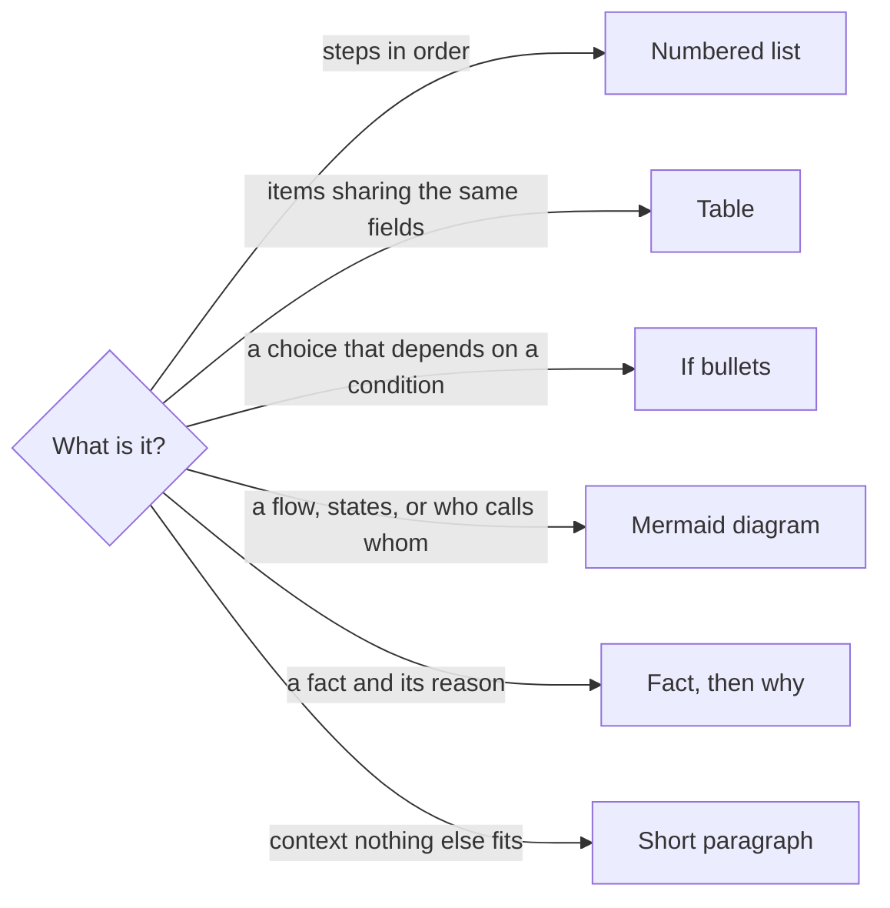

# Markdown

How a document here is meant to read. `rumdl` checks the syntax; this file
is about the shape.

A reader scans before reading. Give them structure to scan.

- It is for documents people read: the docs, the READMEs.
- Instructions written for agents are exempt. Not every agent follows a link
  to another file, so one long, self-contained file can serve them better.
  The project's ignore list keeps them out of the check.

## The rules

- **No wall of prose.** A paragraph is three lines at most, a list item four.
- **One idea per line or bullet.** Two ideas are two bullets.
- **Structure over sentences.** Pick the shape from what the content is.
- **A long file is suspect.** Past 200 lines of text, it holds two
  documents: split it, or open it with a map.
- **Lead with the answer.** The first lines say what the page decides or
  does; the reasoning comes after.

## Pick the shape



A condition reads best as its own bullet:

- If the job is `queued` and its lease is stale, the worker died.
- If the job is `in_progress` and its lease is hot, it is running.

Not: "When a job is queued, it may be that its lease is stale, in which
case…".

## Mermaid

GitHub, Azure DevOps, VS Code and Obsidian render a ` ```mermaid ` block.
Draw one when the reader would otherwise rebuild a picture in their head:

- a state machine: `stateDiagram-v2`;
- who calls whom, in order: `sequenceDiagram`;
- a topology or a pipeline: `graph LR` or `graph TD`;
- what runs where, an ecosystem: `graph` with one `subgraph` per place;
- how types nest or inherit: `classDiagram`, rather than a table of fields;
- a decision: a `{question}` node, in `graph LR` past three branches.

### Shape it for a page read top to bottom

A diagram the reader has to zoom into is a failed diagram.

- A sequence of steps runs down: `graph TD`. A long chain in `graph LR`
  runs off the right edge.
- One node opening many branches turns sideways: `graph LR` stacks the
  branches one under the other, as in the diagram above.
- Three or four nodes side by side at most. Wider, regroup them or split
  the diagram.
- No crossing edges. A node everything points to (a database, a shared
  library) tangles the drawing: leave it out, and say it in one bullet below.
- Declare nodes, then edges, in the order you want them read, left to
  right. Within a row the layout keeps that order, edge labels included:
  most crossings are a declaration out of order.
- If two edges still cross whatever the order, one of them is a detail.
  Move it to the bullet that names what the diagram leaves out.
- A `subgraph` is one thing and its parts: a service and its components, a
  provider family and its members. Nodes grouped only because they look
  alike, then linked across, pull the layout apart.
- A simplified diagram says so in its caption, and names what it leaves out
  in a bullet below.
- An outcome reached from several places (refused, failed) is drawn once per
  place: a ladder of small leaves reads better than arrows converging.
- Two to four words in a node. The detail goes in the text below it.
- Look at it rendered before keeping it. If you had to zoom, redraw it.

### Color what people remember

A reader remembers a component by its color. Give each one the same color
in every diagram, its brand's when it has one, with white text so it reads
in a light or a dark theme. Copy the classes, never invent a shade:

```text
classDef postgres fill:#336791,stroke:#23486a,color:#ffffff
classDef rabbitmq fill:#ff6600,stroke:#b34700,color:#ffffff
classDef storage fill:#2e7d32,stroke:#1b5e20,color:#ffffff
class postgres postgres
```

- Color the shared components only. A diagram where everything is colored
  highlights nothing.

### Keep it to what every renderer draws

- `graph`, never `flowchart`;
- no `---->` long arrow, no HTML in labels, no link to a `subgraph`;
- ten nodes or so. A bigger diagram is two diagrams.

An ASCII drawing in a `text` block is a diagram waiting to be converted:
it cannot be searched, resized or kept in step.

## The check

[markdown-smell.sh](../checks/markdown-smell.sh) reports, on the lines the
working tree added:

| Smell | What it is |
| --- | --- |
| `PARAGRAPH` | A paragraph past three lines, a list item past four |
| `LENGTH` | A file past 200 lines of text that grew; code blocks and diagrams are not counted |
| `ASCII` | A box or arrow drawing in a code block |
| `MERMAID` | A `flowchart` or `---->`, a node with more than four branches side by side, a long chain in `graph LR` |
| `CROSSING` | Edges that cross where another declaration order would not; it prints that order |

Like the comment check, it judges only what a change adds: an old long
paragraph never blocks an unrelated edit, it only stops growing.
