# Emitter Optimizer — where the "emitters" should go

[](LICENSE)
[](https://www.python.org/)
[](https://astral.sh/uv)
[](https://just.systems/man/en/)
[](ideas/roadmap.md)
[](.agents/kanon.md)

**Where do I put my emitters?** Give the tool a map, a weight per place, the walls
and the law of your emitter; it returns the positions that capture the most, and
for coverage by disks, **a proof of how far any placement is from the best one**.

| What it does | What it does not |
| --- | --- |
| Searches continuous positions with a differentiable gain, under your own laws | Model real propagation: the laws are yours, and the examples are illustrative |
| [Proves the optimum](docs/benchmark/certified-method.md) for disks behind walls | Prove anything for a soft law, beyond measuring it |
| Publishes [180 instances](docs/benchmark/certified.md) with their optimum | Rest on field measurements: no case was validated on a real site |

<p align="center">
  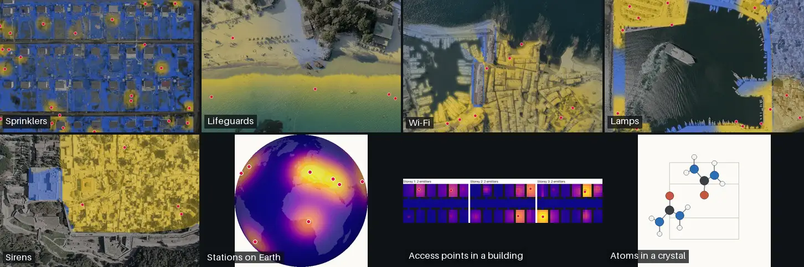
</p>

<p align="center"><em>One engine, eight problems. Change the map and two laws;
the code stays the same. Every figure on this page is generated from a seeded run.</em></p>

## Start here

| If you want | Go to |
| --- | --- |
| Install it and see it work | [Try it](#try-it) |
| Understand the model | [The model](#the-model) |
| See a problem solved, step by step | [The cases](#the-cases) |
| Know why a descent gets stuck, and how it gets out | [Local minima](docs/local-minima.md) |
| Change the physics | [What you can change](#what-you-can-change) |
| How far from the proved optimum | [docs/benchmark/certified.md](docs/benchmark/certified.md) |
| The numbers, case by case | [docs/benchmark/results.md](docs/benchmark/results.md) |
| Every application we can imagine, unsimulated for the most part | [ideas/applications/README.md](ideas/applications/README.md) |
| The status, the layout and the demo | [docs/project.md](docs/project.md) |
| The plan and the open questions | [ideas/roadmap.md](ideas/roadmap.md) |
| Dependencies | Python 3.14+, `just`; `uv` installs JAX, plotly, scikit-image and Pillow |

### The cases

Each one has its own page: the decision, why it is hard, the result, the limits.

| Case | The question | What it proves |
| --- | --- | --- |
| [Plants](docs/cases/plants.md) | Where does the water go? | The naive one, and everything else is this |
| [Garden](docs/cases/garden.md) | Where do 24 sprinklers go? | A short reach blinds the gradient |
| [Beach](docs/cases/beach.md) | Who reaches the swimmer in time? | A few emitters, each one defensible |
| [Marina](docs/cases/marina.md) | Where does Wi-Fi reach the old town? | A wall is a cliff in the gain |
| [Harbor](docs/cases/harbor.md) | How do you light every quay? | A threshold is the hardest law |
| [Ramparts](docs/cases/ramparts.md) | Who hears the siren? | When optimizing adds little, it says so |
| [Globe](docs/cases/globe.md) | Where do 12 stations serve the world? | Only the distance changes |
| [Sphere](docs/cases/sphere.md) | Does it find a known optimum? | Regular solids, within 0.1° |
| [Building](docs/cases/building.md) | How do you cover three storeys? | Walls can absorb, not only block |
| [Urea](docs/cases/urea.md) | Can emitters locate atoms? | 0.03 Å, where a grid stops at 0.39 Å |

## The problem, in one picture

<p align="center">
  
</p>

*Left: the demand in grey, the walls in black, the emitters in red. Right: the
score the engine maximizes — bright places are well served, dark places are
not. The walls cut the signal: a place behind a wall receives nothing from an
emitter in front of it, whatever the distance.*

## The model

The score is the **gain** $\mathcal G_P$, maximized over the emitter positions
$U$. The parameters are $P := (E, \mu, C)$:

- $E$ — the map.
- $\mu$ — a density measure over $E$: a non-negative weight per place.
- $C$ — the segments that block the signal.
- $U$ — the positions of the emitters.

Two laws are the user's:

- $\varphi : \mathbb{R}^+ \to \mathbb{R}$ — the signal received from one
  emitter at a given distance.
- $\psi : \mathbb{R} \to \mathbb{R}$ — the score of a sensor that receives a
  sum of signals.

The path through the obstacles and the distance are

$$
pass_C : (x, y) \mapsto 1 - \prod_{s \in C} \left(1 - \mathbb{1}_{[x; y] \cap s}\right),
\qquad
dist : (x, y) \mapsto \lVert x - y \rVert_2 .
$$

The received signal at a place, and the gain over the map:

$$
r_{U, C}(x) = \sum_{y \in U} \varphi\bigl(dist(x, y)\bigr) \cdot pass_C(x, y),
\qquad
\mathcal G_P(U) = \int_E \psi \circ r_{U, C}(x) \, d\mu(x).
$$

The integral is a mean over the cells of the grid; with a normalized density it
is the expected score of a random place. $\mathcal G_P$ is differentiable in
$U$ everywhere except across a wall, and the kernel computes the gradient with JAX
autodiff:

$$
\frac{\partial \mathcal G_P}{\partial y}
= -\frac{1}{\lvert E \rvert} \sum_{x \in E}
  \psi'\bigl(r_{U, C}(x)\bigr) \,
  \varphi'\bigl(dist(x, y)\bigr) \,
  \frac{x - y}{\lVert x - y \rVert_2} \,
  pass_C(x, y) \, \mu(x).
$$

This is the 2023 baseline, kept as the reference every newer model is compared
against ([ideas/model](ideas/model/README.md)).

## Multiple situations, one engine

Each case starts from a vertical aerial photograph. Two layers are painted
over it at the photograph's own resolution, as one would in an image editor:
the **attraction** (where the demand is) and the **collision** (what blocks the
signal). The engine discretizes both onto its grid — the mean attraction of a
cell, and a wall wherever a quarter of the cell is wall — then runs the same
descent with the laws $\varphi$ and $\psi$ that fit the physics; distances are in metres.

In the animations, blue demand is not served yet and yellow is. White lines are
the descent, orange lines the [jumps out of a local minimum](docs/local-minima.md).

### The same map, three laws

<p align="center">
  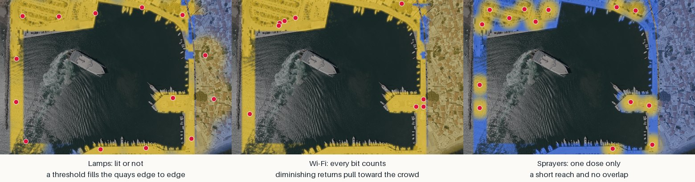
</p>

*The same harbour and the same 14 emitters: **the law is the decision**.*

### [Garden: water the beds, not the sheds](docs/cases/garden.md)

<p align="center">
  
</p>

- **Why it is here**: the hardest case for a gradient: past its throw a sprinkler feels no dry bed at all.
- **The result**: descent alone ends 27–31% below the best known; relocated, within 0.9%.

### [Beach: who gets to the swimmer in time](docs/cases/beach.md)

<p align="center">
  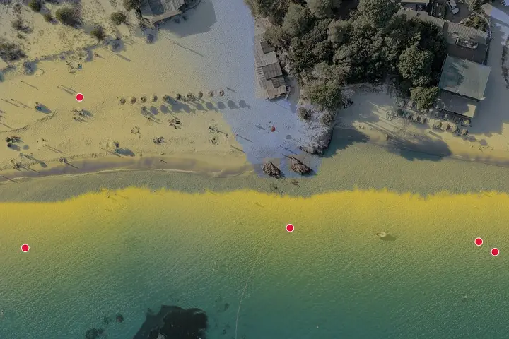
</p>

- **Why it is here**: few emitters and a shallow optimum: each post is a decision someone signs.
- **The result**: +21% above random; every relocated start ends within 0.1% of the best.

### [Marina: Wi-Fi over yachts and an old town](docs/cases/marina.md)

<p align="center">
  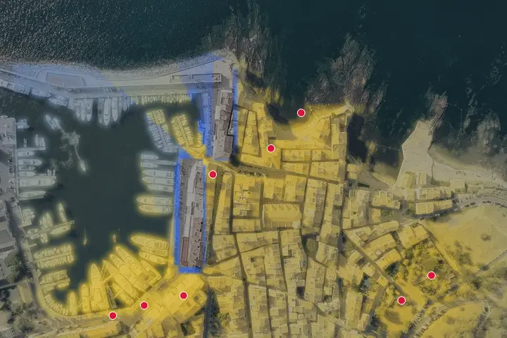
</p>

- **Why it is here**: the law never reaches zero, yet a wall still traps an antenna on its side.
- **The result**: +15% above random; every relocated start ends within 0.1% of the best.

### [Harbor: a quay is lit or it is not](docs/cases/harbor.md)

<p align="center">
  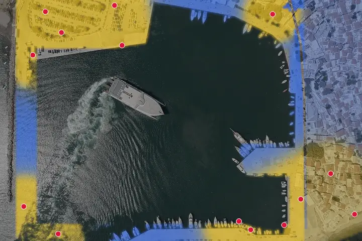
</p>

- **Why it is here**: a threshold law is flat almost everywhere, so only the edge of the light pulls.
- **The result**: +43% above random and +2.3% above greedy, the widest margin of the five.

### [Ramparts: the sound stops at the wall](docs/cases/ramparts.md)

<p align="center">
  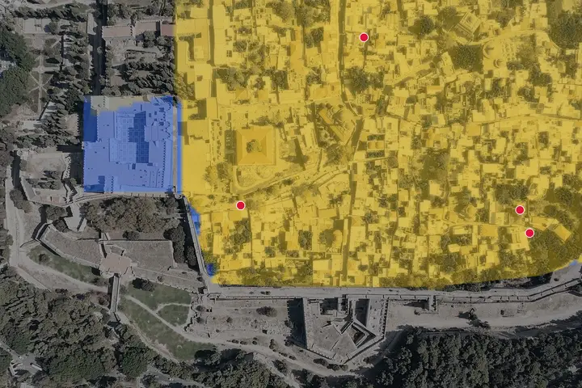
</p>

- **Why it is here**: the honest case: a random placement already does most of the job.
- **The result**: +5% above random, and every start agrees: little is left to find.

## Beyond the plane

The gain only asks a space for its points, its measure and its distance, so the
same descent runs on a sphere, in a building and in a crystal.

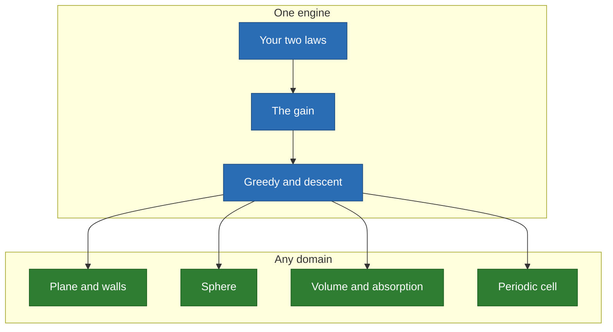

### A sphere that finds the regular solids

Nothing in the code knows a polyhedron. On a uniform sphere, the emitters settle
into the tetrahedron, the octahedron and the icosahedron, within a tenth of a
degree ([the page](docs/cases/sphere.md), [why the optimum is known](ideas/model/sphere.md)).

<p align="center">
  
</p>

### Three more cases

| Case | Result | What it shows |
| --- | --- | --- |
| [**globe**](docs/cases/globe.md) |  | Twelve stations serving the 243 cities of Natural Earth, weighted by population.<br><br>$\varphi(\theta) = e^{30 (\cos \theta - 1)}$ over the geodesic angle.<br><br>Gain 0.0102, against 0.0075 at random. |
| [**building**](docs/cases/building.md) | 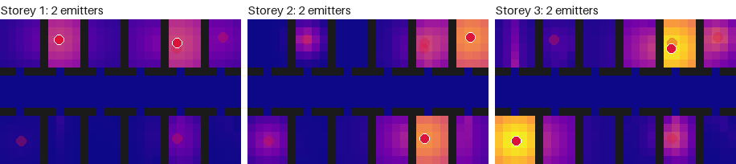 | Six access points on three storeys; concrete absorbs the signal along each sight line.<br><br>$\varphi(d) = 1 / (1 + (d/4)^2)$, times $e^{-\int \alpha}$.<br><br>Gain 0.1173, against 0.1109 for greedy and 0.0664 at random. |
| [**urea**](docs/cases/urea.md) | 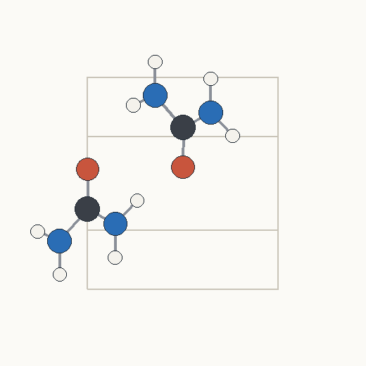 | Emitters find the 16 atoms of a urea cell in a density computed from the published structure.<br><br>Heavy atoms within 0.03 Å, hydrogens within 0.03 Å, where a grid search stops at 0.39 Å.<br><br>The density is synthetic ([limits](ideas/model/urea.md)). |

## Try it

```sh
just install   # uv sync: Python 3.14 and the dependencies
just demo      # optimize the demo map into out/demo/
just run       # open the DearPyGui window
```

The `run` command takes the same options as the window, and a seed:

```sh
uv run python -m emitter_optimizer run --density my-field.png --collisions walls.png \
    --emitters 50 --iterations 200 --seed 0 --out out/my-plan
```

Add `--relocate` to jump out of a local minimum: `just case garden --relocate`.

`emitter-optimizer window --density my-field.png --solve` opens the window
on the optimized result instead of a random start.

## For agents

The kernel is headless; the service speaks JSON on localhost:

```sh
just agent::serve --density resources/map/value_001.png --emitters 15 --seed 0 &
just agent::run 200 0
just agent::query '.gain'
just agent::figure out/plan.png
```

`just agent::serve` prints the address and binds `127.0.0.1`; nothing leaves
the machine. The routes, the request shapes and the skill are in
[AGENTS.md](AGENTS.md#for-agents-the-local-service).

## What you can change

| What | Where | Notes |
| --- | --- | --- |
| Emitter law $\varphi$ | `settings/emitter.py` | `eval(distance)`, optional `derivative` |
| Sensor law $\psi$ | `settings/sensor.py` | `eval(signal)`, optional `derivative` |
| Density $\mu$ | `--density`, or the window | a grayscale image, one weight per cell |
| Obstacles $C$ | `--collisions`, or the window | a mask, or a CSV of segments |
| Number of emitters | `--emitters`, or the window | fixed today; chosen automatically later |
| The map | `--map-scale`, `--grid-size` | width and height, rows and columns |
| The descent | `--iterations`, `--step-size`, `--seed` | see [reproducibility](docs/benchmark/results.md#reproducibility) |
| The escape | `--relocate` | jumps out of a local minimum, then polishes |

A law is a `jax.numpy` function: one array in, one array out. The kernel takes
its slope by autodiff; there is no `derivative` to write
([ideas/engine/functions.md](ideas/engine/functions.md)).

## Local minima

A gradient only feels the slope under an emitter, so a descent stops on the
nearest hill. **A relocation** then moves one emitter at a time to the place
that helps most ([measurements and limits](docs/local-minima.md)).

<p align="center">
  
</p>

- **Reliability**: on all five cases, the starts end within 0.9% of each other,
  when alone they end up to 5.9% apart.
- **Garden is the extreme**: descent alone ends 27–31% below the best known.
- **Limits**: on these laws, no proof of a global optimum, and only 4 starts per case.

## Benchmark

`just bench` generates [the table](docs/benchmark/results.md): a relocation
beats random by 5% to 60% and greedy by 0.1% to 2.3%. Greedy alone reaches most
of the gain; the descent earns its place off the grid, as on urea.

<p align="center">
  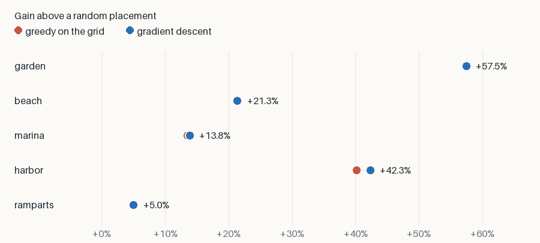
</p>

## How good is it, provably?

For coverage by disks behind walls, the optimum can be proved, so the engine can be
graded instead of compared to itself.

<p align="center">
  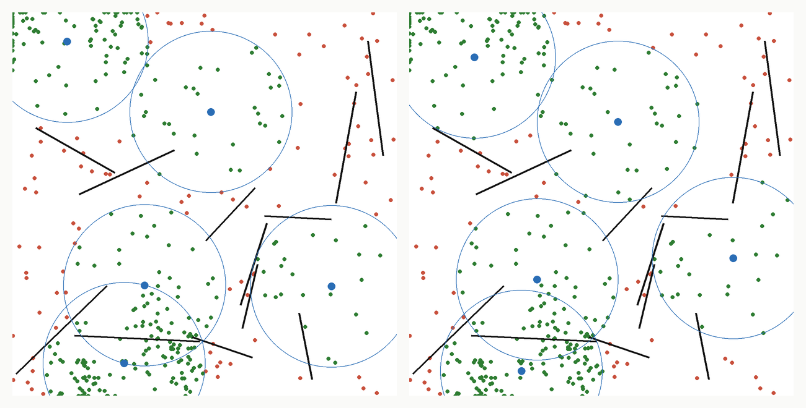
</p>

| Method, on 180 instances with a proved optimum | Mean gap | Worst |
| --- | ---: | ---: |
| Exact, sites restricted to the demand points | 6.00% | 16.62% |
| Exact on a 32 by 32 grid | 2.45% | 11.30% |
| **This engine: relocation and polish** | **1.80%** | **8.55%** |
| Exact on a 64 by 64 grid | 1.21% | 6.38% |

- **The discrete habit is costly**: fixing the sites in advance loses 6% on average.
- **The engine is not the best tool here**: a fine grid beats it, and on these
  sizes the proof is faster than the search (median 1 s against 7 s).
- **On a published map as disks**, garden's relocation ends 17.7% below the optimum.

```sh
just certify    # regenerate the optima, the gaps and the page
emitter-optimizer exact --points demand.csv --walls walls.csv --radius 12 \
    --emitters 5 --map-scale 100 100 --plan my-plan.csv
```

[The method, its attacks and its limits](docs/benchmark/certified-method.md);
[the report](report/certified-coverage.typ), compiled by `just report`.

## Standing on

- **Facility location and maximum coverage**: k-center, k-median and the
  greedy `1 - 1/e` guarantee — the classical answers, and the baselines a
  richer model has to beat ([baselines](ideas/model/baselines.md)).
- **Differentiable rendering and soft visibility**: where the smooth
  replacement of a binary visibility test comes from
  ([occlusion](ideas/engine/occlusion.md)).
- **VLSI placement**: quadratic and analytical placement, the mature field the
  circuit case meets ([circuits](ideas/model/circuits.md)).
- **Ewald summation and Riemannian optimization**: the tools of the periodic
  and constrained cases ([manifolds](ideas/model/manifolds.md)).

The full list is in [ideas/prior-art.md](ideas/prior-art.md); a crossover with
a point-cloud project is sketched in [ideas/crossover.md](ideas/crossover.md).

## Contributors

- **Phorcys** ([Ophiase](https://github.com/Ophiase)): author
- **Eunomia**: the AI agent working with Phorcys. In Greek,
  *Eunomia* is good order: the right thing in the right place.

See [CONTRIBUTORS.md](CONTRIBUTORS.md). The project grew out of a 2023 student
project and was largely rewritten with an AI agent in 2026, under the author's review.

## Licence

[Apache 2.0](LICENSE). Milestones are in [CHANGELOG.md](CHANGELOG.md); how to
contribute in [CONTRIBUTING.md](CONTRIBUTING.md), and to report a flaw in
[SECURITY.md](SECURITY.md).
