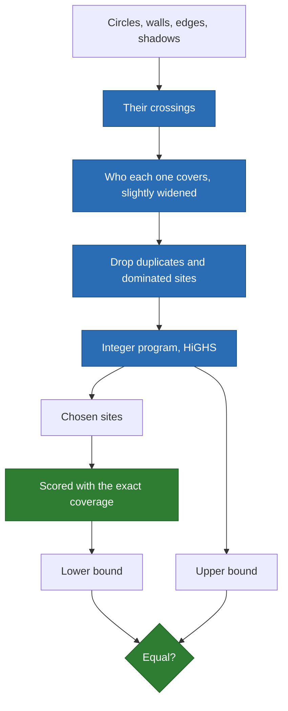

# How the optimum is proved

**The solver turns a continuous problem with walls into a finite one, solves it
exactly, and checks the answer against a separate scoring.** The numbers are in
[certified.md](certified.md).

## The problem

- Points with integer weights, a radius, disjoint wall segments, `k` emitters.
- A point is covered if an emitter is within the radius, and no wall properly
  crosses their sight line.
- The score is the covered weight. Emitters may stand anywhere in the rectangle.

## Why a finite set is enough

1. The place an emitter must stand to cover one point is a region: a disk minus
   the shadows of the walls. It is star-shaped around that point.
2. Take any emitter and the points it covers. They share a region, the intersection
   of their regions, with no hole, since each complement reaches infinity.
3. Inside it, the emitter can slide to a corner, where two boundaries meet, and
   still cover them all. With no corner, the region is a whole disk, and its
   centre, a point of the problem, covers them.
4. So the crossings of all boundaries, the wall ends and the points hold an optimal
   placement. Without walls this is Church's circle intersection result.

A crossing that lies on a wall is taken twice, once per side, since an emitter
does not see through the wall it stands against.

## The steps



- **Upper bound**: every site covers within a slack of `1e-6`, wider than the
  scoring, so rounding cannot hide a better placement.
- **Lower bound**: the chosen placement, scored at `1e-9`, like anyone else's.
- **The proof is the comparison**: equal bounds are measured, never assumed.

## How it was attacked

| Attack | What happens |
| --- | --- |
| A search over a 301 by 301 grid, on 24 small instances | Never passes the bound |
| The published kernel's coverage, on random placements | Agrees within 0.1% of pairs |
| All subsets of 12 candidates, against the integer program | Same answer |
| By-hand cases: a circle's centre, a wall, a wall's end | The expected answer |
| Removing the circle crossings from the set | The grid search catches it, 10 of 18 |
| Removing circle and segment crossings | Caught, 1 of 18 |
| Removing the shadows | Caught, 1 of 18 |
| Removing segment crossings | **Not caught**, 0 of 18 |

The last line is a real limit: on these small instances, no optimum needs those
crossings, so this attack says nothing about them.

## The limits

- **Disks only.** A soft law, or signals that add up, is outside the proof.
- **No peer review.** The argument above is ours; the attacks test it, they do not
  replace it.
- **Floating point.** HiGHS works with tolerances. Integer weights give the bound
  a margin, but this is not an exact-arithmetic proof.
- **Synthetic instances.** The reference set is random, not drawn from a survey.
- **Touching walls.** The argument assumes disjoint walls. Masks produce touching
  ones; there the upper bound stays valid, and equal bounds are still checked.
- **Scale.** The candidates grow quickly with points and radius. See the times in
  [certified.md](certified.md); past the time limit the bound holds but may stay open.

## Use the reference set without our solver

Each record of `resources/reference/coverage-with-walls.json` holds an instance,
its `optimum`, and a placement that reaches it. To score your heuristic:

```python
import json

import numpy as np

from emitter_optimizer.kernel.placement.exact import Instance

for record in json.load(open("resources/reference/coverage-with-walls.json")):
    instance = Instance.of(record)
    covered = instance.covered_weight(your_positions(instance))
    print(instance.name, 100 * (record["optimum"] - covered) / record["optimum"])
```

## Judge your own plan

```sh
emitter-optimizer exact --points demand.csv --walls walls.csv --radius 12 \
    --emitters 5 --map-scale 100 100 --plan my-plan.csv
```

It writes `positions.csv` and `certificate.json`. `percent_below_the_bound` is how
far your plan can be from the best one, at most.
