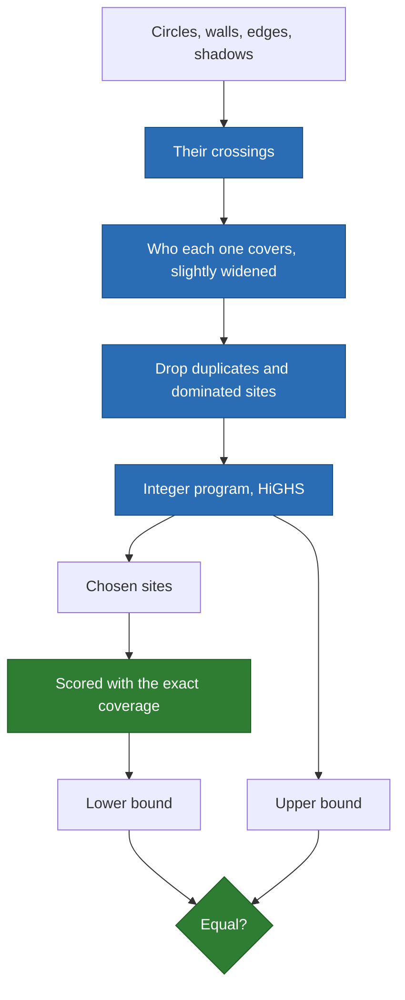

# How the optimum is proved

**The solver turns a continuous problem with walls into a finite one, solves it
exactly, and checks the answer against a separate scoring.** The numbers are in
[certified.md](certified.md).

## The problem

- Points with integer weights, a radius, disjoint wall segments, `k` emitters.
- A point is covered if an emitter is within the radius, and no wall properly
  crosses their sight line.
- The score is the covered weight. Emitters may stand anywhere in the rectangle.

## Why a finite set is enough

**Claim.** Let `D` hold the points, the wall ends, and every crossing between
the circles, the walls, the map edges and the shadow edges, a crossing on a wall
being taken once per side. Some optimal placement lies in `D`.

**Proof.** Let `V(x)` be where an emitter covers point `x`: a closed disk minus
the shadows of the walls, star-shaped around `x`.

1. Take an optimal emitter `y` and the set `S` of points it covers. Let `C` be the
   connected component of `y` in the intersection of `V(x)` over `S`.
2. The complement of each `V(x)` is connected and unbounded, so `C` has no hole.
3. If the boundary of `C` has a corner, it is a crossing or a curve end, so it lies
   in `D`, and an emitter there still covers `S`.
4. If it has none, it is one full circle, so `C` is a disk around a point of `S`,
   and that point lies in `D` and covers `S`.
5. Moving each emitter in turn never shrinks what is covered.

A point on a wall is reached from one side only, hence the two copies. Without
walls this is Church's circle intersection result.

**Status: on paper, by the agent, unreviewed.** The attacks below test it.

## The steps



- **Upper bound**: every site covers within a slack of `1e-6`, wider than the
  scoring, so rounding cannot hide a better placement.
- **Lower bound**: the chosen placement, scored at `1e-9`, like anyone else's.
- **The proof is the comparison**: equal bounds are measured, never assumed.

## How it was attacked

| Attack | What happens |
| --- | --- |
| A search over a 301 by 301 grid, on 24 small instances | Never passes the bound |
| Every other method, on all 180 reference instances | Never passes the bound |
| The published kernel's coverage, on random placements | Agrees within 0.1% of pairs |
| All subsets of 12 candidates, against the integer program | Same answer |
| By-hand cases: a circle's centre, a wall, a wall's end | The expected answer |
| Removing each class of candidates, on 200 small instances | See below |

Removing a class is caught when the bound falls below a placement that really
scores higher, so no search is needed. Each class matters:

| Class removed | Instances where the bound becomes false |
| --- | ---: |
| Shadows | 57 of 200 |
| Segment crossings | 15 of 200 |
| Circle crossings | 3 of 200 |
| Circle and segment crossings | 3 of 200 |

## How much to trust each claim

| Claim | Trust | Evidence |
| --- | --- | --- |
| A finite set suffices | Paper, unreviewed | The proof above |
| Equal bounds on the reference set | Measured | `just certify`, by comparison |
| No search passes a bound | Tested | The first two attacks |
| Each candidate class is needed | Tested | The table above |
| The upper bound under rounding | Numerical | HiGHS tolerances, integer weights |
| Useful to practitioners | **Inferred** | A gap in the tools we read; nobody was asked |

## The limits

- **Disks only.** A soft law, or signals that add up, is outside the proof.
- **No peer review.** The argument above is ours; the attacks test it, they do not
  replace it.
- **Floating point.** HiGHS works with tolerances. Integer weights give the bound
  a margin, but this is not an exact-arithmetic proof.
- **Synthetic instances.** The reference set is random, not drawn from a survey.
- **Touching walls.** The argument assumes disjoint walls. Masks produce touching
  ones; there the upper bound stays valid, and equal bounds are still checked.
- **Scale.** The candidates grow quickly with points and radius; the times are in
  [certified.md](certified.md). Past the program's time limit the bound holds but
  may stay open, and the listing before the program has no limit at all.

## Use the reference set without our solver

Each record of `resources/reference/coverage-with-walls.json` holds an instance,
its `optimum`, and a placement that reaches it. To score your heuristic:

```python
import json

import numpy as np

from emitter_optimizer.kernel.placement.exact import Instance

for record in json.load(open("resources/reference/coverage-with-walls.json")):
    instance = Instance.of(record)
    covered = instance.covered_weight(your_positions(instance))
    print(instance.name, 100 * (record["optimum"] - covered) / record["optimum"])
```

## Judge your own plan

```sh
emitter-optimizer exact --points demand.csv --walls walls.csv --radius 12 \
    --emitters 5 --map-scale 100 100 --plan my-plan.csv
```

It writes `positions.csv` and `certificate.json`. `percent_below_the_bound` is how
far your plan can be from the best one, at most.
