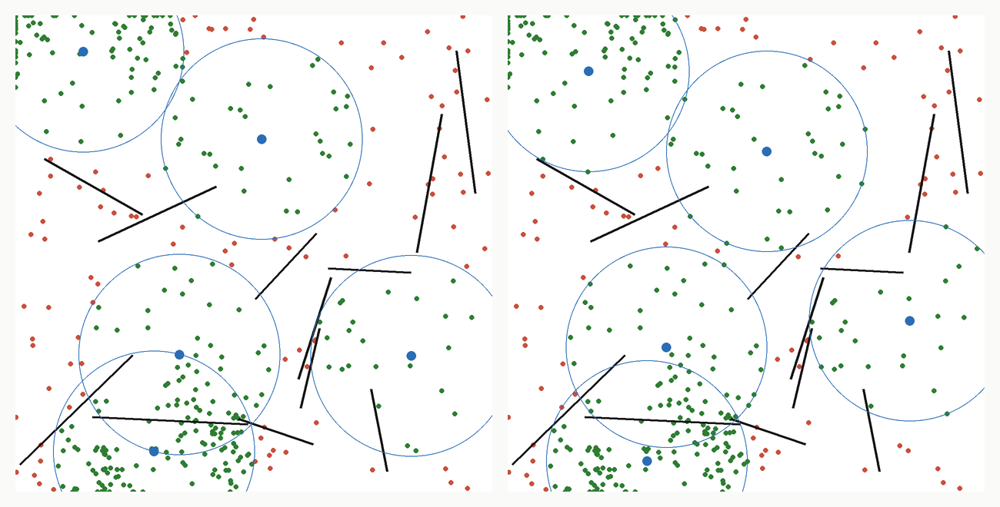

# How far from the proved optimum

`just certify` writes this page and
[the reference set](../../resources/reference/coverage-with-walls.json).
[The method and its limits](certified-method.md) are on their own page.

**180 of 180 reference instances are solved to a proved
optimum.** Every gap below is measured against it: `(optimum - covered) / optimum`.

*Left, the best placement if emitters must stand on a demand point; right, the
proved optimum. Green points are covered, red are not, black lines are walls.*

- **Discrete solvers** are exact over their sites, as spopt's formulation is.
- **The grid of 64 by 64** is the one the engine jumps on.
- **The seconds** depend on the machine; the optima do not.

## The reference set

| Method | mean gap | median | 95th percentile | worst | optimum reached |
| --- | ---: | ---: | ---: | ---: | ---: |
| Random, 32 draws | 40.23% | 39.83% | 48.38% | 56.42% | 0 of 180 |
| Exact on the demand points | 6.00% | 5.74% | 10.37% | 16.62% | 0 of 180 |
| Exact on a 16 by 16 grid | 4.80% | 4.67% | 8.53% | 15.13% | 1 of 180 |
| Exact on a 32 by 32 grid | 2.45% | 2.16% | 4.97% | 11.30% | 9 of 180 |
| Exact on a 64 by 64 grid | 1.21% | 1.12% | 3.20% | 6.38% | 16 of 180 |
| Greedy on the 64 by 64 grid | 3.40% | 3.34% | 6.63% | 10.79% | 3 of 180 |
| Engine: descent | 2.99% | 2.66% | 5.52% | 11.64% | 2 of 180 |
| Engine: relocation and polish | 1.80% | 1.56% | 3.64% | 8.55% | 5 of 180 |

## By number of walls

| walls | instances | 32 by 32 grid | 64 by 64 grid | descent | relocation | exact, median seconds |
| ---: | ---: | ---: | ---: | ---: | ---: | ---: |
| 0 | 60 | 1.80% | 0.95% | 2.79% | 1.65% | 1.0 |
| 4 | 60 | 2.29% | 1.07% | 2.77% | 1.57% | 0.7 |
| 12 | 60 | 3.27% | 1.62% | 3.42% | 2.17% | 1.3 |

## By number of emitters

| emitters | instances | 32 by 32 grid | 64 by 64 grid | descent | relocation | exact, median seconds |
| ---: | ---: | ---: | ---: | ---: | ---: | ---: |
| 3 | 45 | 3.11% | 1.61% | 2.73% | 1.66% | 2.9 |
| 5 | 45 | 2.38% | 1.26% | 3.20% | 1.44% | 1.0 |
| 10 | 45 | 2.41% | 1.21% | 3.37% | 2.15% | 0.7 |
| 20 | 45 | 1.90% | 0.76% | 2.68% | 1.95% | 0.5 |

## By number of points

| points | instances | 32 by 32 grid | 64 by 64 grid | descent | relocation | exact, median seconds |
| ---: | ---: | ---: | ---: | ---: | ---: | ---: |
| 100 | 60 | 1.93% | 1.01% | 2.97% | 1.58% | 0.2 |
| 200 | 60 | 2.53% | 1.14% | 3.08% | 1.86% | 0.8 |
| 400 | 60 | 2.90% | 1.48% | 2.93% | 1.96% | 6.0 |

## The published maps, as disks

Each case of the [benchmark](results.md), with its law reduced to the disk one
emitter serves alone. These are not the laws of that benchmark, so the two tables
do not compare.

| map | points | walls | emitters | covered | proved | exact seconds | 64 by 64 grid | descent | relocation |
| --- | ---: | ---: | ---: | ---: | --- | ---: | ---: | ---: | ---: |
| garden | 726 | 255 | 24 | 12578 | yes | 34 | 16.45% | 17.74% | 17.74% |
| beach | 576 | 43 | 5 | 15294 | yes | 521 | 0.50% | 1.07% | 0.64% |
| marina | 507 | 34 | 8 | 8551 | yes | 8 | 5.89% | 4.40% | 4.40% |
| harbor | 345 | 17 | 14 | 14516 | yes | 3 | 4.79% | 5.97% | 4.11% |
| ramparts | 388 | 47 | 4 | 25019 | no, 0.10% open | 694 | 0.41% | 0.41% | 0.41% |

## How far it scales

- **3200 points, 40 emitters, 12 walls** did not finish: stopped by hand after 22
  minutes, before the integer program.
- **The time limit binds the integer program only**, not the listing before it.

| points | emitters | walls | candidates | kept | proved | seconds |
| ---: | ---: | ---: | ---: | ---: | --- | ---: |
| 800 | 10 | 12 | 202783 | 2996 | yes | 38 |
| 1600 | 20 | 12 | 423287 | 10039 | yes | 393 |
