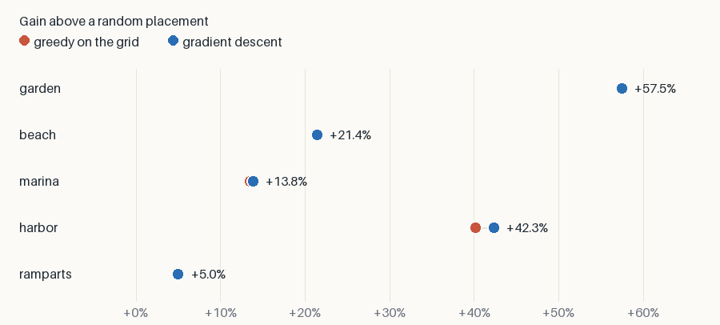

# Benchmark

Every gain comes from the same scene, with sharp walls.

- **Random**: the mean of 32 placements drawn from the demand.
- **Greedy**: emitters added one by one on the grid.
- **Descent**: the better of 4 free starts and of a polish of greedy.

What it says:

- **Greedy reaches most of the gain**; the descent adds at most 1.6%.
- **The descent earns its place elsewhere**: it needs no grid, and greedy costs
  too much past a few thousand candidates.
- A dot hides another when they tie.

`just bench` writes this page.

| case | emitters | random | greedy | descent | above random | seconds |
| --- | ---: | ---: | ---: | ---: | ---: | ---: |
| garden | 24 | 0.0388 | 0.0611 | 0.0611 | +57.5% | 359.5 |
| beach | 5 | 0.1174 | 0.1423 | 0.1425 | +21.4% | 15.6 |
| marina | 8 | 0.2424 | 0.2752 | 0.2759 | +13.8% | 16.8 |
| harbor | 14 | 0.1572 | 0.2202 | 0.2237 | +42.3% | 24.9 |
| ramparts | 4 | 0.3403 | 0.3567 | 0.3573 | +5.0% | 23.4 |
