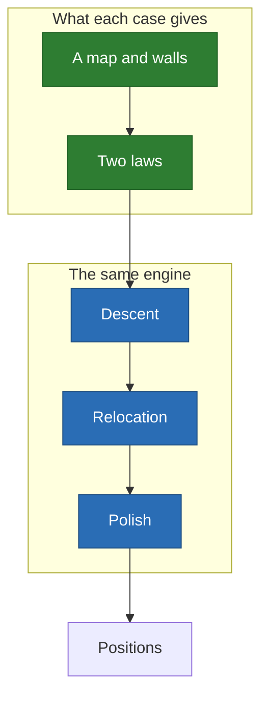

# The cases

Nine problems, one engine: only the map and the two laws change.

## On a photograph

| Case | Emitters | The question | What it proves |
| --- | ---: | --- | --- |
| [Garden](garden.md) | 24 | Where do the sprinklers go? | A short reach blinds the gradient |
| [Beach](beach.md) | 5 | Who reaches the swimmer in time? | A few emitters, each one defensible |
| [Marina](marina.md) | 8 | Where does Wi-Fi reach the old town? | A wall is a cliff in the gain |
| [Harbor](harbor.md) | 14 | How do you light every quay? | A threshold is the hardest law |
| [Ramparts](ramparts.md) | 4 | Who hears the siren? | When optimizing adds little, it says so |

## Beyond the plane

| Case | Space | The question | What it proves |
| --- | --- | --- | --- |
| [Sphere](sphere.md) | Uniform sphere | Does it find a known optimum? | Regular solids, within 0.1° |
| [Globe](globe.md) | The Earth | Where do 12 stations serve the world? | Only the distance changes |
| [Building](building.md) | A volume | How do you cover three storeys? | Walls can absorb, not only block |
| [Urea](urea.md) | A periodic cell | Can emitters locate atoms? | 0.03 Å, where a grid stops at 0.39 Å |

The cases on a photograph share [one benchmark](../benchmark/results.md). The
search itself is explained in [local minima](../local-minima.md).
