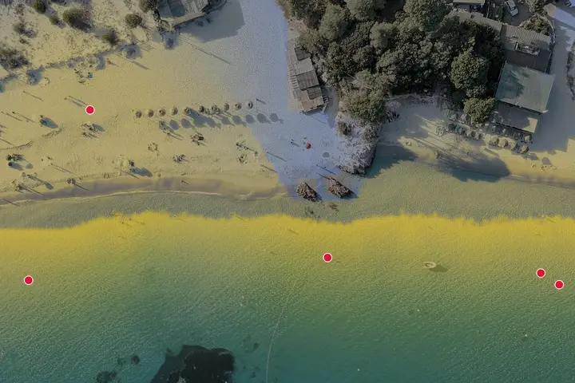
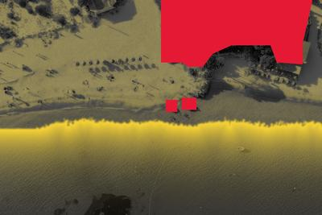
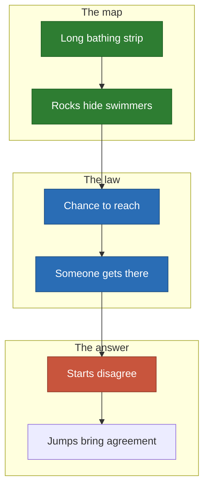
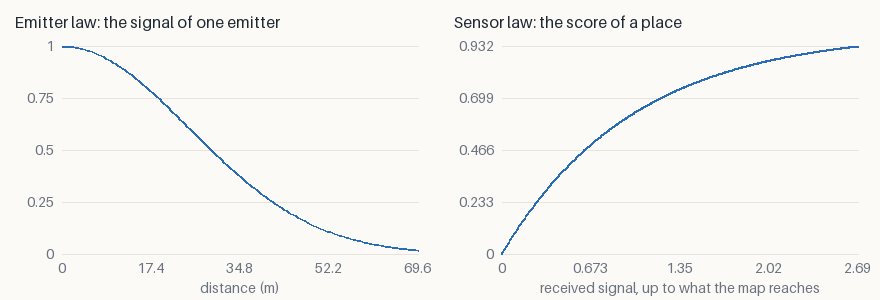
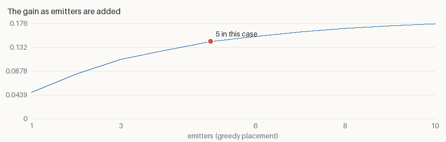

# Beach: who gets to the swimmer in time

Five lifeguards over the bathing strip of Palombaggia, Corsica. The headland and
the rocks hide part of the water. **With so few emitters, each position is a
decision someone defends.**

<p align="center">
  
</p>

*Blue demand is not served yet, yellow is. White lines are the descent, orange
lines the [jumps](../local-minima.md). One start, seed 0.*

## The decision

- **Who decides**: whoever signs the safety plan of a beach.
- **The cost of a mistake**: a swimmer nobody can reach in time.

## What goes in

<p align="center">
  
  
</p>

*The photograph, then the two layers painted over it: attraction in yellow,
collision in red.*

## Why it is hard



- **Few emitters, wide reach**: the optimum is shallow, and starts end close:
  1.8% apart on the machine that wrote this page, 0.1% on a second one.
- **The rocks are small**: they cut only a little of the water, so most of the
  map rewards any close post.

## The two laws

- **Emitter**: $\varphi(d) = e^{-(d/35)^2}$ — the chance to reach a swimmer in
  time.
- **Sensor**: $\psi(s) = 1 - e^{-s}$ — the chance that someone gets there.



## What it found

| Emitters | Random | Greedy | Descent | Relocation | Spread alone | Spread relocated |
| ---: | ---: | ---: | ---: | ---: | ---: | ---: |
| 5 | 0.1174 | 0.1423 | 0.1424 | **0.1425** | 1.8% | 0.0% |

- **+21% above random, +0.1% above greedy**: a tiny gain on the best answer.
- **The relocated starts agree** within 0.1%, on both machines. The spread alone
  [did not reproduce](../benchmark/results.md#reproducibility).
- **Two lifeguards end on the same spot** in this start. The law says so, and a
  safety plan would refuse it: a sign that the law needs a term for it.



**The curve bends near 3 and flattens past 5**: doubling the lifeguards adds
about a quarter.

## Limits

- Currents and the crowd's movement during the day are not modelled.
- The law is a plausible shape, not a calibrated rescue time.

## Run it

```sh
just case beach --relocate --iterations 300
```

[All the cases](README.md) · [Local minima](../local-minima.md) ·
[Benchmark](../benchmark/results.md)
