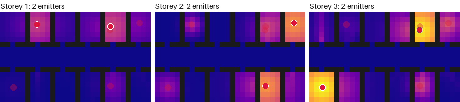
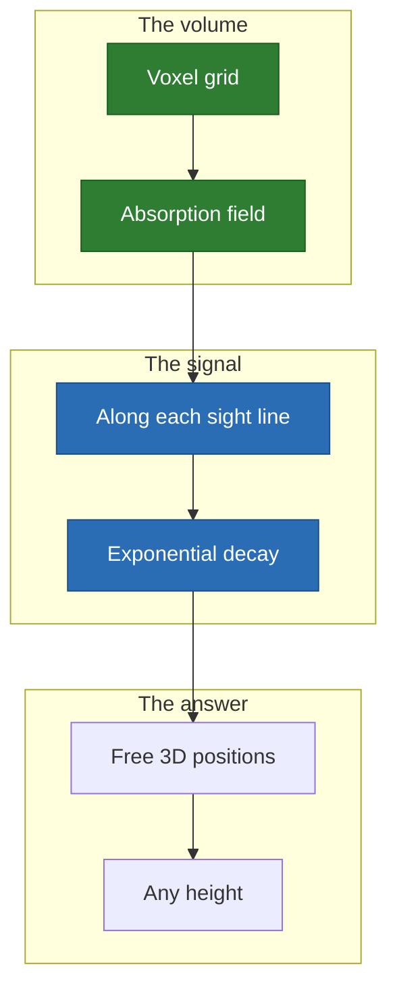

# Building: concrete absorbs, it does not block

Six access points across three storeys, where walls and floors absorb the signal
along each sight line. **Here the descent beats greedy clearly**: greedy only
has a coarse lattice of candidates, and the descent has none.

<p align="center">
  
</p>

## Why it is here



- **Law**: $\varphi(d) = 1 / (1 + (d/4)^2)$, times $e^{-\int \alpha}$ along the
  line.
- **Gain**: 0.1173, against 0.1109 for greedy and 0.0664 at random.

## Limits

- The building is invented: offices along a corridor, no window.
- Absorption values are illustrative, not measured materials.

## Run it

```sh
just space building
```

[All the cases](README.md) · [Local minima](../local-minima.md)
