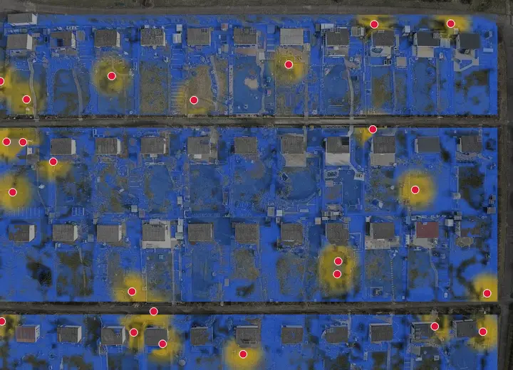
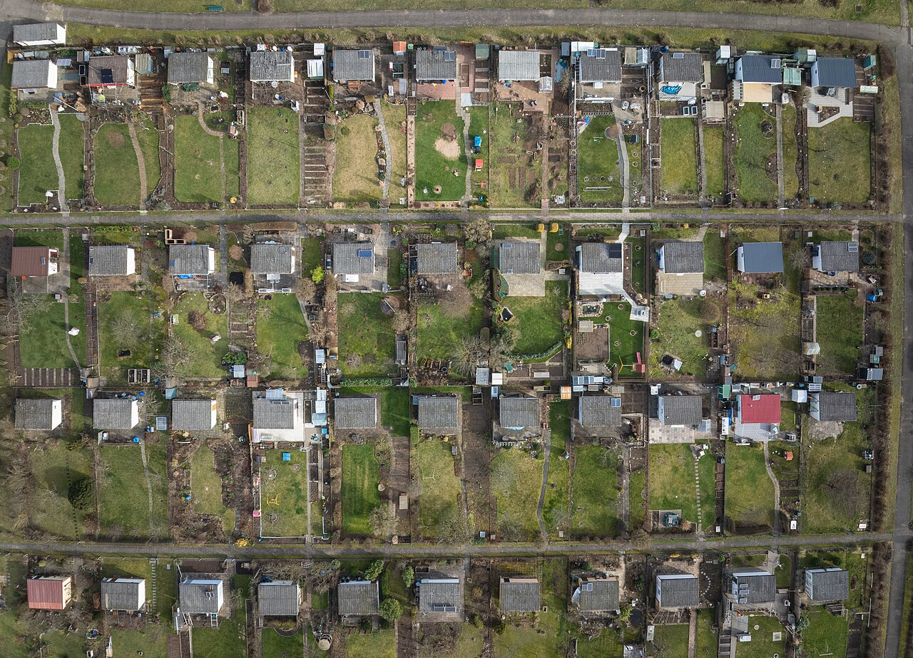
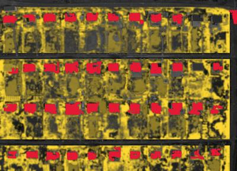
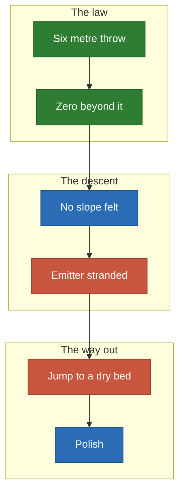
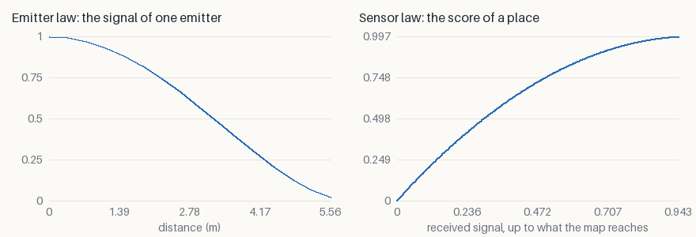
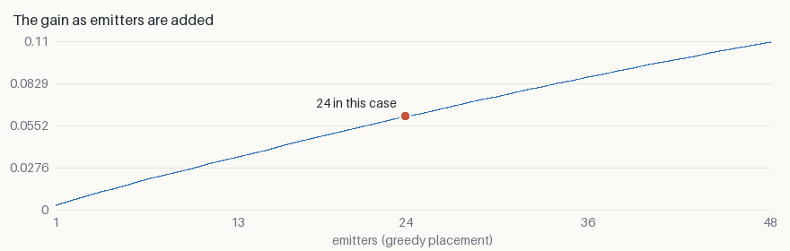

# Garden: water the beds, not the sheds

Twenty-four sprinklers over allotment beds in Bamberg, with sheds that stop the
jet. **This is the case where the descent alone fails**, and it shows why.

<p align="center">
  
</p>

*Blue demand is not served yet, yellow is. White lines are the descent, orange
lines the [jumps](../local-minima.md). One start, seed 0.*

## The decision

- **Who decides**: whoever lays the irrigation of a shared garden.
- **The cost of a mistake**: dry beds on one side, drowned beds on the other.

## What goes in

<p align="center">
  
  
</p>

*The photograph, then the two layers painted over it: attraction in yellow,
collision in red.*

## Why it is hard



- **A compact law blinds the gradient.** Past six metres a sprinkler sends
  nothing, so a dry bed further away exerts no pull at all.
- **The sheds cut the map into cells**, so even a nearby bed can be out of
  sight.

## The two laws

- **Emitter**: $\varphi(d) = \max(0, 1 - (d/6)^2)^2$ — water stops at the throw.
- **Sensor**: $\psi(s) = 1 - (1 - s)^2$ — one dose is ideal, a second drowns the
  bed.



## What it found

| Emitters | Random | Greedy | Descent | Relocation | Spread alone | Spread relocated |
| ---: | ---: | ---: | ---: | ---: | ---: | ---: |
| 24 | 0.0388 | 0.0611 | 0.0611 | **0.0622** | 5.9% | 0.9% |

- **Descent alone ends 27% to 31% below the best known**; relocated, every start
  is within 0.9% of it.
- **+60% above random, +1.8% above greedy.** The jumps are visible: 19 on this
  start.



**24 is far from enough**: the curve is still almost straight at 48, where the
gain nearly doubles.

## Limits

- The beds were painted by hand from one photograph.
- Wind and water pressure are not in the law.

## Run it

```sh
just case garden --relocate --iterations 300
```

[All the cases](README.md) · [Local minima](../local-minima.md) ·
[Benchmark](../benchmark/results.md)
