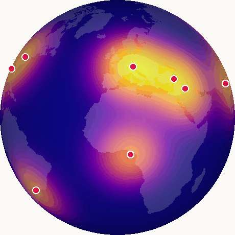
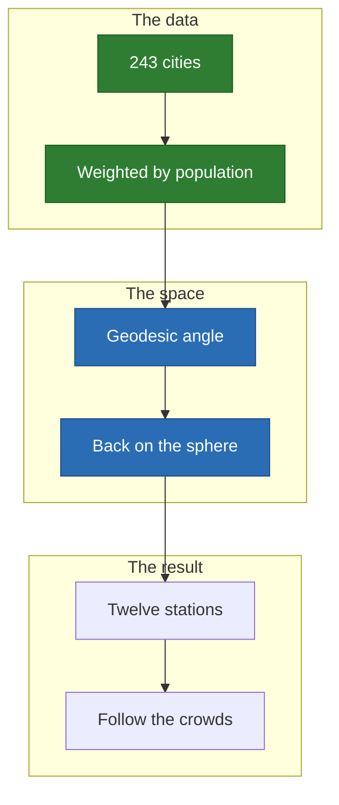

# Globe: twelve stations for the world's cities

Twelve stations on the sphere, serving the 243 cities of Natural Earth weighted
by population. **Nothing in the engine changes: only the distance does.**

<p align="center">
  
</p>

## Why it is here



- **Law**: $\varphi(\theta) = e^{30 (\cos \theta - 1)}$ over the geodesic angle,
  and $\psi(s) = 1 - e^{-s}$.
- **Gain**: 0.0102, against 0.0075 at random.

## Limits

- The density is a smoothed city list, not a measured demand.
- Orbits, ground stations and link budgets are not modelled.

## Run it

```sh
just space globe
```

[All the cases](README.md) · [Local minima](../local-minima.md)
