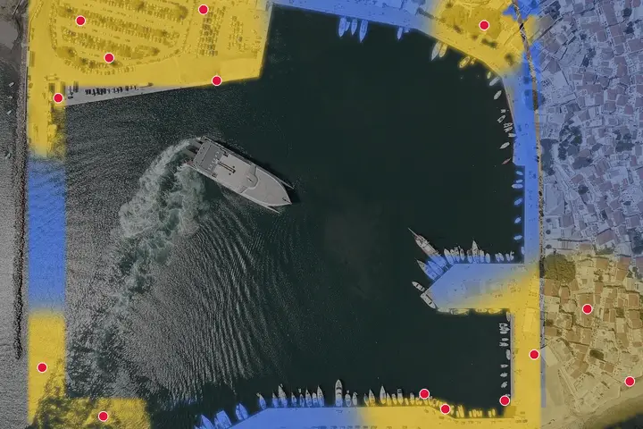
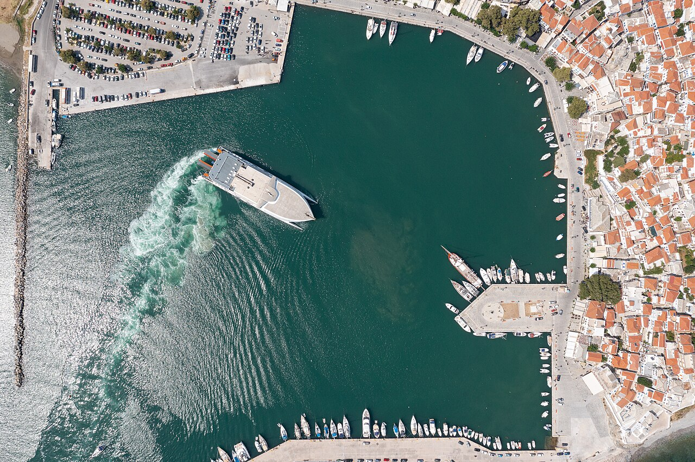
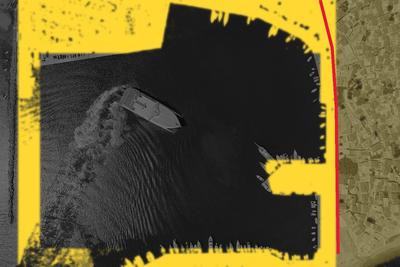
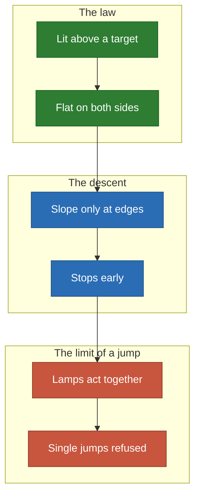
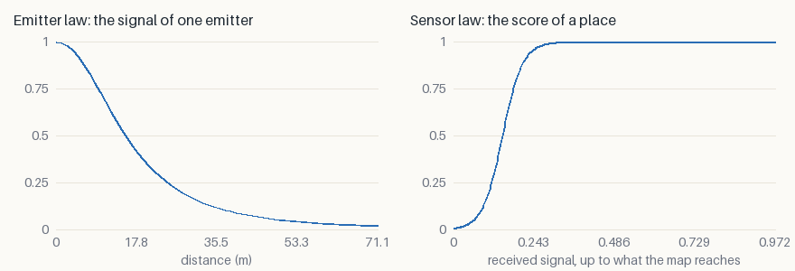
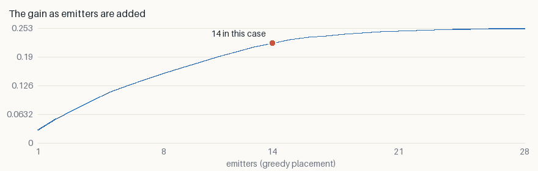

# Harbor: a quay is lit or it is not

Fourteen lamps along the quays and the car park of Skopelos, with the house
fronts casting the shadow. **A threshold law is the hardest shape to climb, and
the map shows it edge to edge.**

<p align="center">
  
</p>

*Blue demand is not served yet, yellow is. White lines are the descent, orange
lines the [jumps](../local-minima.md). One start, seed 0.*

## The decision

- **Who decides**: whoever fits out a ferry port.
- **The cost of a mistake**: a dark stretch of quay where a ramp comes down.

## What goes in

<p align="center">
  
  
</p>

*The photograph, then the two layers painted over it: attraction in yellow,
collision in red.*

## Why it is hard



- **Flat, steep, flat.** Fully lit and fully dark cells both have no slope, so
  only the edges of the light pull a lamp.
- **A dark quay may need two lamps at once**, which a single jump cannot try:
  the likely reason why one start finds no jump.

## The two laws

- **Emitter**: $\varphi(d) = (1 + (d/20)^2)^{-3/2}$ — the illuminance under a
  pole.
- **Sensor**: $\psi(s) = \sigma((s - 0.15)/0.03)$ — a quay is lit or not; more
  light adds nothing.



## What it found

| Emitters | Random | Greedy | Descent | Relocation | Spread alone | Spread relocated |
| ---: | ---: | ---: | ---: | ---: | ---: | ---: |
| 14 | 0.1572 | 0.2202 | 0.2237 | **0.2252** | 3.5% | 0.8% |

- **+43% above random, +2.3% above greedy**: the widest margin over greedy of
  the five.
- **The start of this animation makes no jump at all**: the spread only falls to
  0.8%.



**It flattens past 14**: the second half of the budget adds about 15%.

## Limits

- A pole's height and a lamp's power are folded into two constants.
- One start of four ends 0.8% below the best: see [local
  minima](../local-minima.md).

## Run it

```sh
just case harbor --relocate --iterations 300
```

[All the cases](README.md) · [Local minima](../local-minima.md) ·
[Benchmark](../benchmark/results.md)
