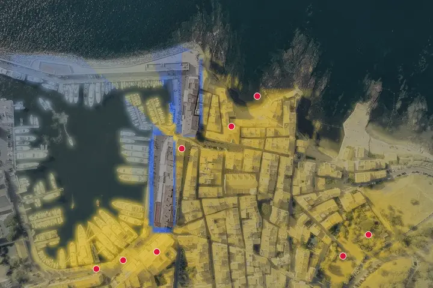
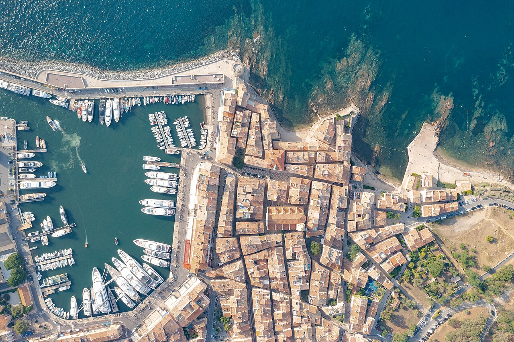
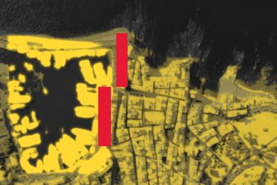
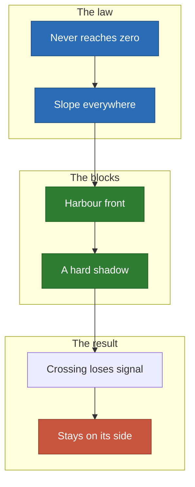
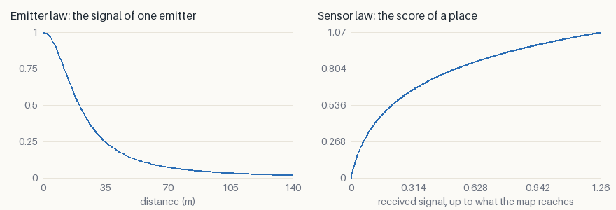
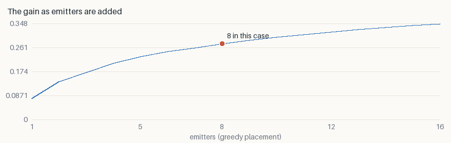

# Marina: Wi-Fi over yachts and an old town

Eight access points over the harbour of Saint-Tropez, with the harbour-front
blocks between the boats and the streets. **Here the gradient always feels
something, and it still gets stuck.**

<p align="center">
  
</p>

*Blue demand is not served yet, yellow is. White lines are the descent, orange
lines the [jumps](../local-minima.md). One start, seed 0.*

## The decision

- **Who decides**: whoever installs a harbour network.
- **The cost of a mistake**: full bars on the quay, nothing one street behind.

## What goes in

<p align="center">
  
  
</p>

*The photograph, then the two layers painted over it: attraction in yellow,
collision in red.*

## Why it is hard



- **A wall is a cliff in the gain.** Crossing it loses a whole shadow before it
  wins the other side, so an access point stays where it is.
- **Diminishing returns** make a second antenna on the crowd worth less, but
  rarely worth nothing.

## The two laws

- **Emitter**: $\varphi(d) = 1 / (1 + (d/20)^2)$ — an inverse square that never
  reaches zero.
- **Sensor**: $\psi(s) = \log(1 + s/N) / \log(1 + 1/N)$ — Shannon throughput,
  diminishing returns.



## What it found

| Emitters | Random | Greedy | Descent | Relocation | Spread alone | Spread relocated |
| ---: | ---: | ---: | ---: | ---: | ---: | ---: |
| 8 | 0.2424 | 0.2752 | 0.2759 | **0.2781** | 2.5% | 0.1% |

- **+15% above random, +1.1% above greedy.**
- **The spread falls to 0.1%**, from 2.5% here and 4.3% on a second machine
  ([reproducibility](../benchmark/results.md#reproducibility)), so the start no
  longer decides the answer.



**It keeps rising**: doubling to 16 access points adds about a quarter.

## Limits

- Walls block fully here; real concrete attenuates (see
  [building](building.md)).
- Interference between access points is not in the gain.

## Run it

```sh
just case marina --relocate --iterations 300
```

[All the cases](README.md) · [Local minima](../local-minima.md) ·
[Benchmark](../benchmark/results.md)
