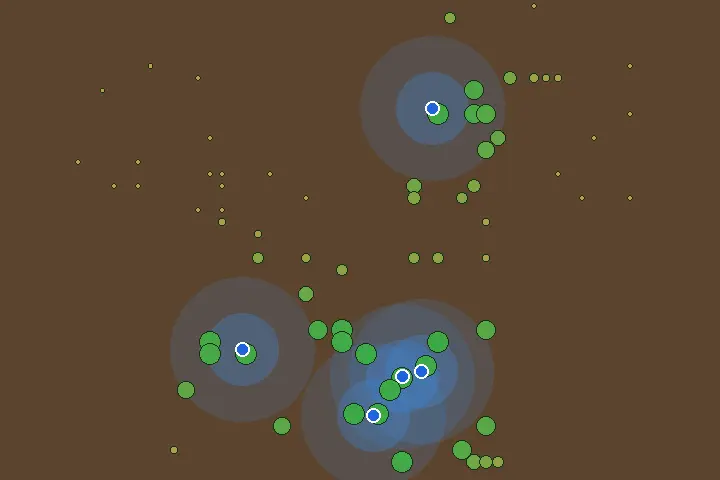
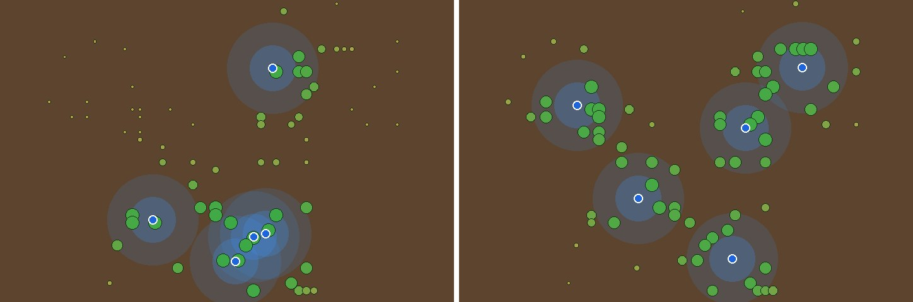
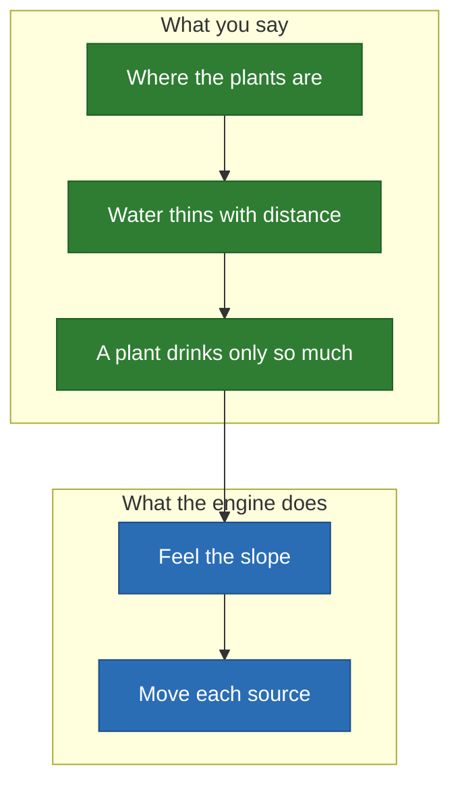

# Plants: water that feeds them

The naive one: five water sources, seventy plants, bare soil. **If you remember
one case, remember this one.** Everything else on this site is the same sentence
with other words.

<p align="center">
  
</p>

*A plant grows with the water it receives. Blue dots are the sources.*

<p align="center">
  
</p>

*Left: the start. Right: the answer.*

## The decision

- **Who decides**: anybody with a watering can.
- **The cost of a mistake**: a wilted plant here, water wasted there.

## How it reads as a model



- **Emitter**: $\varphi(d) = e^{-(d/3)^2}$ — water thins out over 3 metres.
- **Sensor**: $\psi(s) = 1 - e^{-3s}$ — growth saturates: a plant drinks only so
  much.
- **The map**: a plant in a cell or none; no walls.

## What it found

| Placement | Mean growth of a plant |
| --- | ---: |
| Random, 32 draws | 47.0% |
| Greedy on the grid | 65.9% |
| Descent, one start | **69.6%** |

- **Here the descent beats greedy by itself**, and no jump is needed: the law is
  smooth and every plant pulls from a distance.
- **So this is the easy case**, and that is its point: see
  [garden](garden.md) for what changes when a law stops at a short throw.

## Limits

- The plants are generated, not surveyed, and nothing here is agronomy.
- Soil, slope and evaporation are not in the law.

## Run it

```sh
just space plants
```

[All the cases](README.md) · [All the applications we can imagine](../../ideas/applications/README.md)
