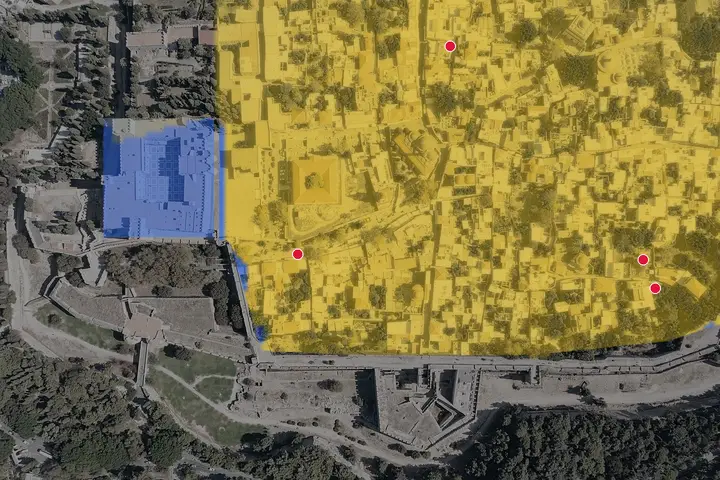
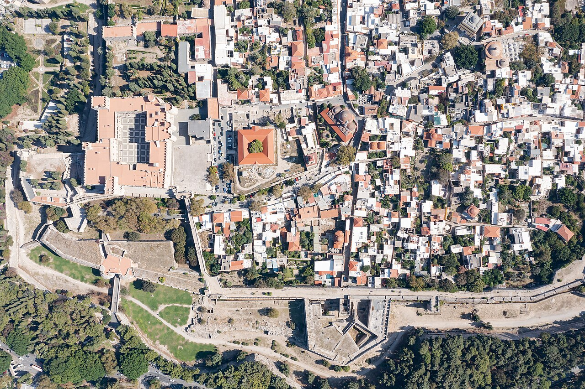
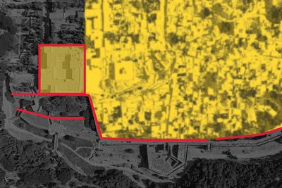
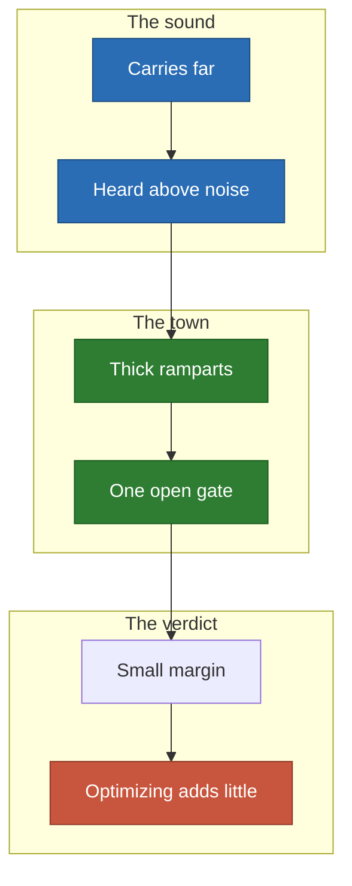
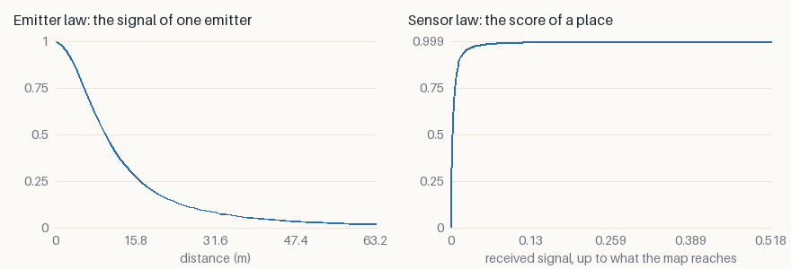
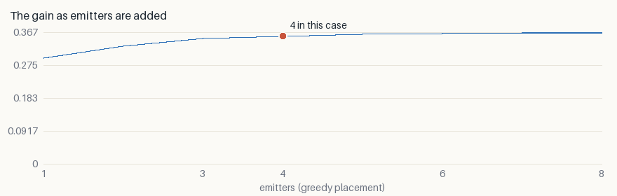

# Ramparts: the sound stops at the wall

Four sirens inside the walled old town of Rhodes. The ramparts stop the sound;
the gate lets it out. **This is the honest case: a random placement already does
most of the job.**

<p align="center">
  
</p>

*Blue demand is not served yet, yellow is. White lines are the descent, orange
lines the [jumps](../local-minima.md). One start, seed 0.*

## The decision

- **Who decides**: whoever plans an alert for a walled town.
- **The cost of a mistake**: a district that does not hear it.

## What goes in

<p align="center">
  
  
</p>

*The photograph, then the two layers painted over it: attraction in yellow,
collision in red.*

## Why it is hard



- **Long reach, small town**: with so much range almost any four spots are
  heard, which makes the margin small.
- **That is a result too**: a tool that says when optimizing is not worth much
  is more credible than one that always wins.

## The two laws

- **Emitter**: $\varphi(d) = e^{-d/300} / (1 + (d/10)^2)$ — spreading and air
  absorption.
- **Sensor**: $\psi(s) = \sigma((10 \log_{10} s + 25)/3)$ — heard once it clears
  the street noise.



## What it found

| Emitters | Random | Greedy | Descent | Relocation | Spread alone | Spread relocated |
| ---: | ---: | ---: | ---: | ---: | ---: | ---: |
| 4 | 0.3403 | 0.3567 | 0.3573 | **0.3580** | 0.1% | 0.0% |

- **+5% above random, +0.4% above greedy**, the smallest margins of the five.
- **All starts agree within 0.1%, even alone.** There is little left to find.



**The first siren does most of the work**: doubling from 4 to 8 adds about 3%.

## Limits

- Sound also bends over walls; here a wall stops it completely.
- Street noise is one constant over the whole town.

## Run it

```sh
just case ramparts --relocate --iterations 300
```

[All the cases](README.md) · [Local minima](../local-minima.md) ·
[Benchmark](../benchmark/results.md)
