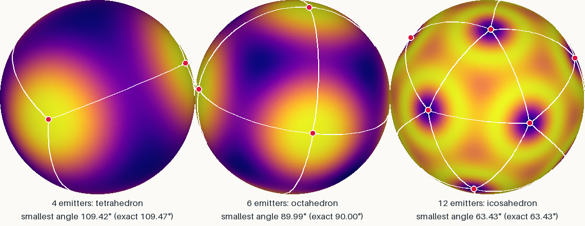
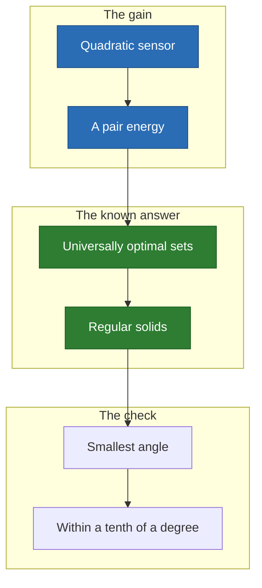

# Sphere: the regular solids, found by nothing but a gain

On a uniform sphere the emitters settle into a tetrahedron, an octahedron and an
icosahedron. **Nothing in the code knows a polyhedron**, and here the right
answer is known.

<p align="center">
  
</p>

## Why it is here



- **Why it matters**: this is the one case with an exact answer to check the
  engine against ([the proof sketch](../../ideas/model/sphere.md)).
- **Expected angles**: 109.47°, 90.00° and 63.43°.

## Limits

- The grid discretizes the integral, so the angles hold within a tolerance.
- Another sensor law breaks the pair energy, and the answer is no longer known.

## Run it

```sh
just space thomson
```

[All the cases](README.md) · [Local minima](../local-minima.md)
