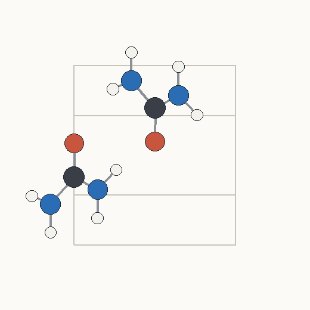
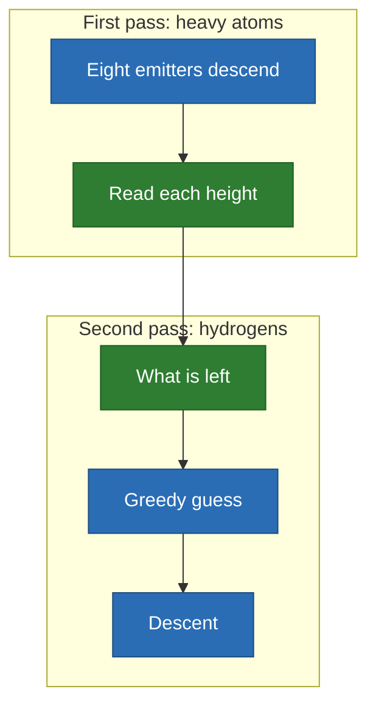

# Urea: finding atoms in a crystal

Emitters find the 16 atoms of a urea cell in a density computed from the
published structure, within 0.03 Å. **A grid search on the same problem stops at
0.39 Å.**

<p align="center">
  
</p>

## Why it is here



- **Where the descent earns its place**: the grid is 0.23 Å wide, and the
  emitters land far inside a cell.
- **Free descent alone misses hydrogens**: 6 of 8 from 32 starts. It takes
  greedy on the residual to get all 8 ([details](../../ideas/model/urea.md)).

## Limits

- **The density is synthetic**: no noise, no thermal smearing, no phase problem.
- A measured map is the honest next step.

## Run it

```sh
just space urea
```

[All the cases](README.md) · [Local minima](../local-minima.md)
