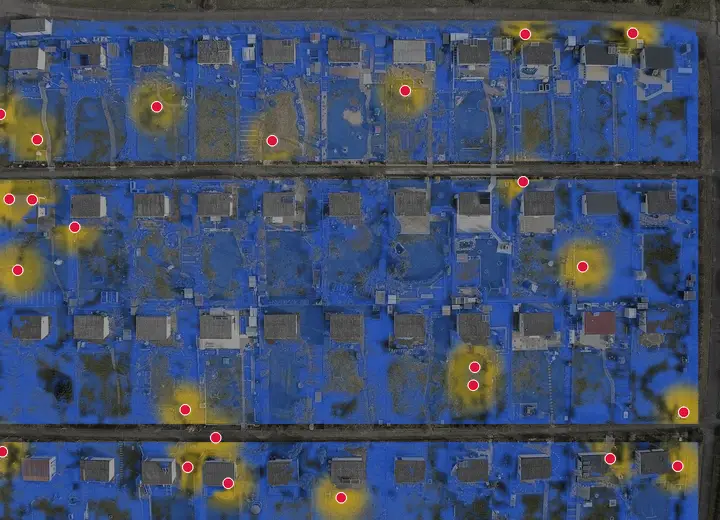
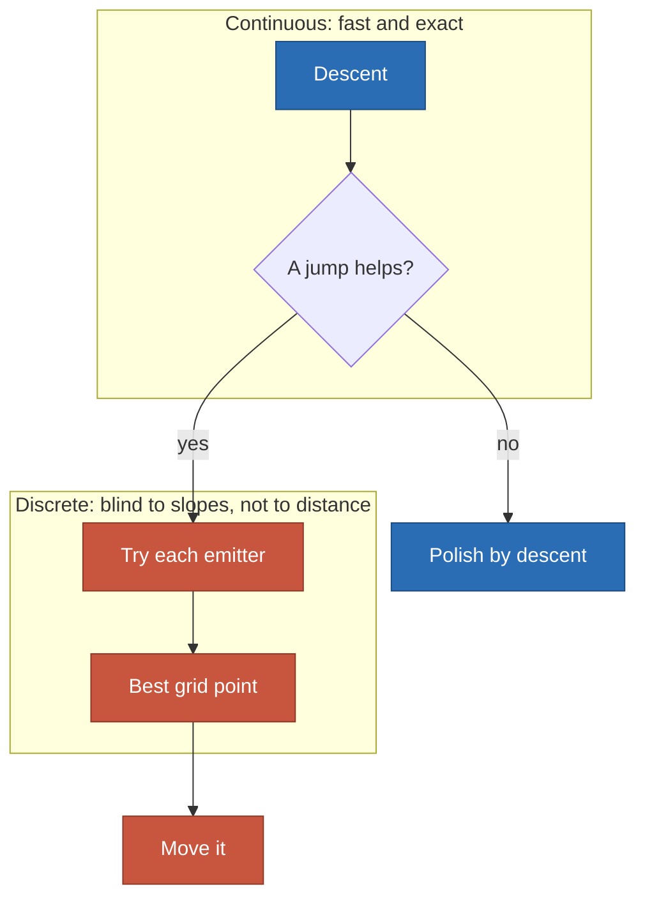
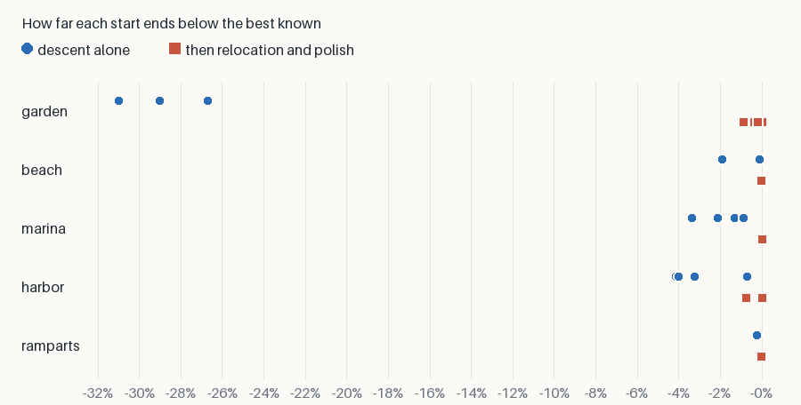

# Local minima

**A gradient only feels the slope under an emitter, so a descent stops on the
nearest hill.** A relocation jumps past it, and the result stops depending much
on the start.

  

*Garden, one start. The white lines are the descent; the orange ones are the
jumps it could never have made.*

## What traps a descent

- **A short reach**: past its throw a sprinkler sends nothing, so a dry bed
  further away exerts no pull at all.
- **Crowding**: two emitters share one peak while another peak stays unserved.
- **A wall**: crossing it loses a whole shadow before it wins the other side.
- **A threshold**: fully lit and fully dark cells both have no slope.

## The way out

- **The jump never lowers the gain**: it is taken only if the gain rises.
- **The two steps need each other**: a jump lands on the grid, and the polish
  takes it off the grid again.
- `--relocate` on the command line, `"relocate": true` on the service, and
  `Relocation` in the kernel.

## What it measures

| Case | Random | Greedy | Descent | Relocation | Above greedy | Spread alone | Spread relocated |
| --- | ---: | ---: | ---: | ---: | ---: | ---: | ---: |
| garden | 0.0388 | 0.0611 | 0.0611 | **0.0622** | +1.8% | 5.9% | 0.9% |
| beach | 0.1174 | 0.1423 | 0.1424 | **0.1425** | +0.1% | 1.8% | 0.0% |
| marina | 0.2424 | 0.2752 | 0.2759 | **0.2781** | +1.1% | 2.5% | 0.1% |
| harbor | 0.1572 | 0.2202 | 0.2237 | **0.2252** | +2.3% | 3.5% | 0.8% |
| ramparts | 0.3403 | 0.3567 | 0.3573 | **0.3580** | +0.4% | 0.1% | 0.0% |

*Four starts per case; "Descent" is the better of those starts and of a polish
of greedy. [Full benchmark](benchmark/results.md).*

- **The start stops mattering**: the spread falls on all five cases.
- **Garden is the extreme**: alone, every start ends 27% to 31% below.
- **The final gain moves little**, 0.1% to 2.3% above greedy, which is already
  a strong baseline. The gain here is reliability more than height.

## What else was tried

| Method | Result | Kept |
| --- | --- | --- |
| Several starts | Useful, but a matter of luck: the spread stays | Yes, in the benchmark |
| A law widened, then tightened | Beats the descent alone; loses to a jump on beach and marina, ties it on harbor | No |
| A relocation | Narrows the spread on every case | Yes |

The widened law was measured on 8 starts of beach and marina and on 3 of
harbor. Garden and ramparts were not finished, so it is not settled there.

## Limits

- **No proof of a global optimum.** A relocation ends in a local optimum of the
  jumps; it is a better trap, not the absence of one.
- **One emitter at a time.** A dark quay that needs two lamps at once refuses
  every single jump: the likely reason why one harbor start makes none.
- **The cost.** Each pass tries every emitter on every candidate over every
  point, so a large domain needs a candidate list, as greedy does.
- **Not new.** Interchange local search is classical for the p-median problem;
  what is measured here is its pairing with a differentiable descent, on these
  laws and walls.
