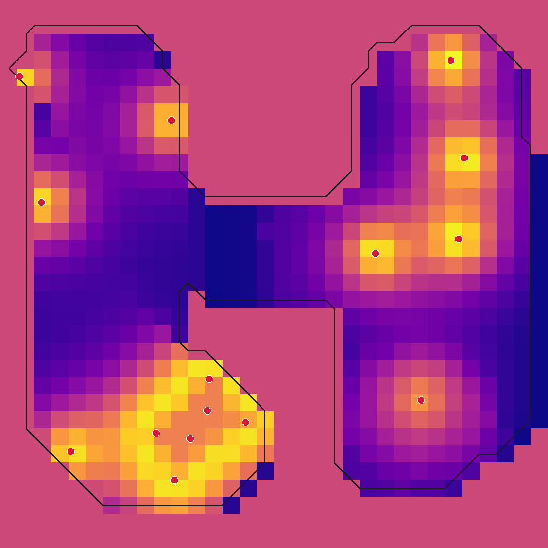
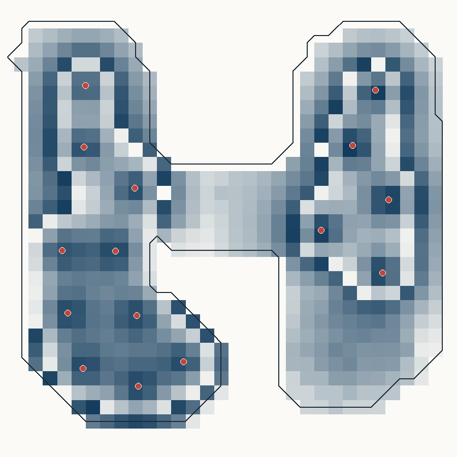
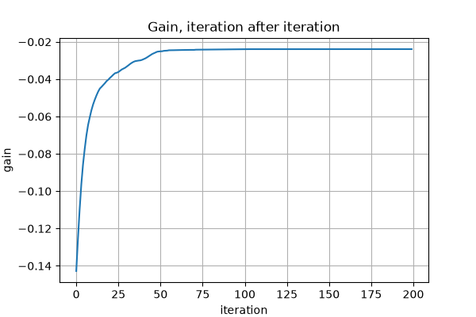

# The project

Where the code stands, how the repository is laid out, and the demo.

## Status

| Part | State |
| --- | --- |
| Gain, value map and gradient, in JAX | Done, autodiff tested against a central difference |
| optax, bounds, abort, best-seen safeguard | Done, tested |
| Laws as `jax.numpy` functions, autodiff | Done, tested |
| Density, collision mask or CSV, non-square grids | Done, Pillow and scikit-image |
| Command line, five use cases, figures and benchmark | Done (`just demo`, `bench`, `figures`) |
| Local page: FastAPI, pydantic, plotly, no build | Done, tested |
| Local service, `agent.just` and the skill | Done ([agent-interop](../ideas/architecture/agent-interop.md)) |
| Coverage, quantile, max-min objectives | Planned ([objective](../ideas/model/objective.md)) |
| A `Domain`: plane, sphere, periodic cell, volume | Done, tested ([manifolds](../ideas/model/manifolds.md)) |
| Baselines: random and greedy | Done ([benchmark](benchmark/results.md)) |
| A proved optimum for disks behind walls | Done, attacked by tests ([method](benchmark/certified-method.md)) |
| Escaping local minima by relocation | Done, tested ([local minima](local-minima.md)) |
| Surfaces, constrained emitters, an implicit energy | Planned ([implicit energy](../ideas/model/implicit-energy.md)) |
| A crossover with the point-cloud project | Sketched ([crossover](../ideas/crossover.md)) |

The questions still open are in [ideas/open.md](../ideas/open.md).

## Roadmap

| Milestone | What | State |
| --- | --- | --- |
| M0 | The baseline, 2023 when I was a student | Done |
| M1 | A headless JAX kernel, a command line, a benchmark | Done |
| M2 | A local service an agent can drive |  Done |
| M3 | A model worth publishing: baselines done; objectives, count | Next |
| M4 | The local page served to agents, beside the DearPyGui window | Done |
| M5 | 3D and manifolds done; constrained emitters, real data | Next |

Every step, its acceptance sentence and how to resume it:
[ideas/roadmap.md](../ideas/roadmap.md).

## The repository

| Folder | What it is |
| --- | --- |
| [ideas/](../ideas/README.md) | Every concept, one per file, with its status: start here |
| [src/emitter_optimizer/kernel/](../src/emitter_optimizer/kernel/) | The JAX kernel: domains, occlusion, coverage, greedy and descent |
| [src/emitter_optimizer/gui/](../src/emitter_optimizer/gui/) | The DearPyGui window: render, process, parameters and the law editors |
| [src/emitter_optimizer/service/](../src/emitter_optimizer/service/) | FastAPI, pydantic models, the session and the local page for an agent |
| [src/emitter_optimizer/maps/](../src/emitter_optimizer/maps/) | Pillow and scikit-image load a density and a wall mask |
| [src/emitter_optimizer/render/](../src/emitter_optimizer/render/) | Pillow draws the map; plotly draws the gain |
| [scripts/](../scripts/) | The benchmark, the figures and the cases beyond the plane |
| [settings/](../settings/) | The two laws the person edits |
| [tests/](../tests/) | A property per guarantee: the gradient, the walls, the grid, the service |
| [docs/cases/](cases/README.md) | One page per case: the decision, the laws, the result, the limits |
| [docs/benchmark/](benchmark/results.md) | The published benchmark, generated by `just bench` |
| [docs/figures/](figures/) | The figures of this page, generated by `just figures` |

Agents working on this code read [AGENTS.md](../AGENTS.md).

## The demo

  
  
  

*A random start, two hundred iterations, and the gain it climbed.*

`just demo` writes four files into `out/demo/`:

| File | Content |
| --- | --- |
| `positions.csv` | the emitters, one `x,y` per line |
| `history.csv` | the loss, iteration after iteration |
| `figure.png` | the value map and the emitters |
| `summary.json` | the final gain, the seed, the parameters |
