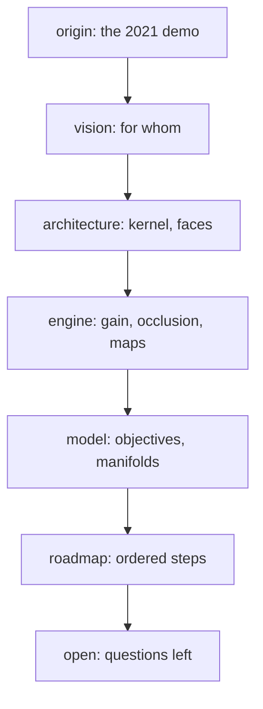

# ideas/ — map

The core of the project: **one concept per file**, short, informal first. Code,
README and figures are written from here; a choice that is not here yet is not
made yet ([AGENTS.md](../AGENTS.md)).

Tags: **[defined]** (fixed by the author), **[sketch]** (argued, unchecked),
**[guess]**, **[to check]** (claim about prior art), **[question]** (the author
decides), **[caution]** (known trap).

## Thesis

Placing emitters on a map is a differentiable optimization problem.

**[guess]** Teams rebuild it for radio planning, irrigation, retail siting or
sensor networks, each with its own script; nobody was surveyed to confirm it.

The project is **one small, typed, fast Python core** that maximizes a gain the
user defines, under obstacles, weighted by a density, and that an **agent can
drive** as easily as a person.

## The path

## Files

- [vision.md](vision.md) · [origin.md](origin.md) ·
  [milestones.md](milestones.md) · [roadmap.md](roadmap.md) ·
  [open.md](open.md) · [prior-art.md](prior-art.md)
- [crossover.md](crossover.md) · [applications](applications/README.md) ·
  [certified-coverage.md](certified-coverage.md)
- **architecture/**: [README](architecture/README.md) — the kernel, the stack,
  the layers, agent interop, zero telemetry, the faces, the language
- **engine/**: [README](engine/README.md) — [gain](engine/gain.md) ·
  [occlusion](engine/occlusion.md) · [map](engine/map.md) ·
  [distance](engine/distance.md) · [functions](engine/functions.md) ·
  [optimizer](engine/optimizer.md) · [autodiff](engine/autodiff.md)
- **Local minima**: [why a descent stops](engine/local-minima.md), and the way out
- **model/**: [README](model/README.md) — objectives, baselines, physics, the
  third dimension, manifolds, the sphere, crystals, constraints

## Where the code stands (v2.4, 2026-11-05)

- **[defined]** One JAX kernel behind a CLI, a local service and a DearPyGui
  window, with five cases from aerial photographs.
- **[sketch]** Next: [certified coverage](certified-coverage.md), on a branch for
  the author to judge; the rest is in the [roadmap](roadmap.md).
