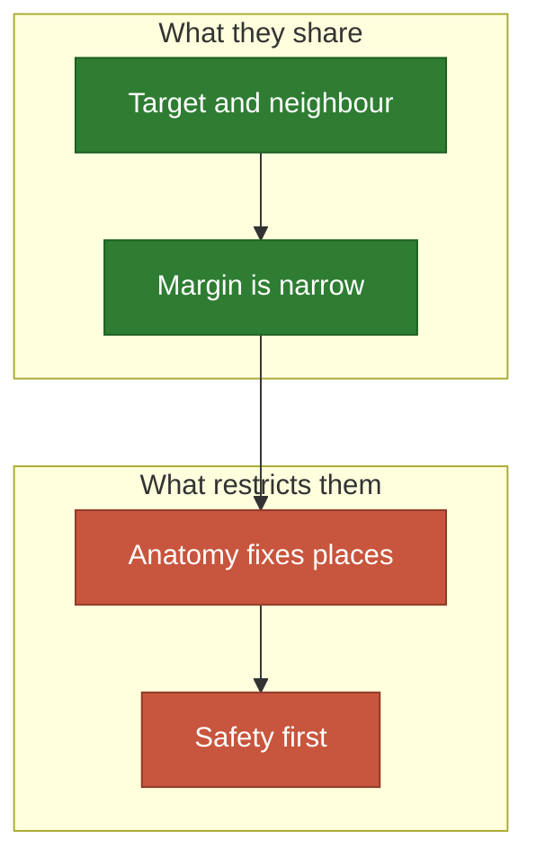
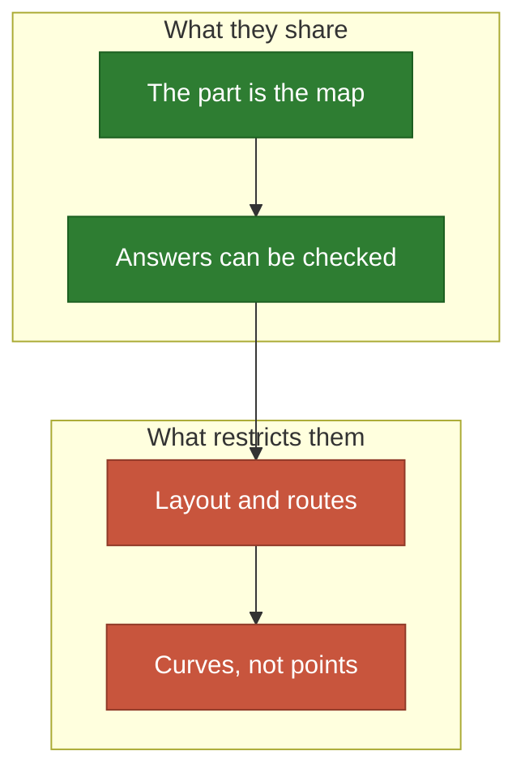

# Bodies and machines

Where the map is an object, and the margin is narrow.

**[sketch]** Rows are unchecked unless marked `Done`; the legend is in
[the map](README.md).

## The body

A narrow margin: hit the target, spare what is beside it.

- **Share**: a gain with two sides, one to reach and one to spare.
- **Often**: signals add and cancel.
- **Restricted by**: anatomy, and a safety bar no mean can trade away. A
  research idea here, never a clinical tool.

| # | Application | Emitter | Wants it | Blocks | The idea | Needs |
| ---: | --- | --- | --- | --- | --- | --- |
| 65 | 🎯 Radiation seeds in a tumour | A seed | The tumour | Bone | Spare the organs beside it | `Objective`, `Place` |
| 66 | Beams in radiotherapy | A beam | The tumour | Spine | Each angle is an emitter | `Aim`, `Objective` |
| 67 | Scalp electrodes | An electrode | A brain target | The skull | Currents add and cancel | `Pairs`, `Place` |
| 68 | Cochlear electrodes | An electrode | Nerve fibres | Bone | A single line in a spiral | `Place`, `Domain` |
| 69 | Ultrasound on a joint | A probe | Inflamed tissue | Bone | Focus is a phase pattern | `Pairs` |
| 70 | Drug implants | An implant | Tissue | Membranes | Diffusion, then clearance | `Time` |
| 71 | 🧠 Directions in a diffusion MRI | A gradient | The sphere | Nothing | A Thomson problem, as is | `Laws` |

## Machines and matter

The object itself is the map, and the answer can be checked.

- **Share**: an exact geometry, and often a known or measurable truth.
- **Often**: the emitter is a curve or a surface, not a point.
- **Restricted by**: routing, tolerances, and the surface it must stay on.

| # | Application | Emitter | Wants it | Blocks | The idea | Needs |
| ---: | --- | --- | --- | --- | --- | --- |
| 72 | ⚛️ [Atoms in a crystal](../../docs/cases/urea.md) | An atom | Electron density | Nothing | Off the grid, within 0.03 Å | `Done` |
| 73 | [Regular solids on a sphere](../../docs/cases/sphere.md) | A point | A uniform sphere | Nothing | The answer is known | `Done` |
| 74 | ⛳ Golf ball dimples | A dimple | The sphere | Nothing | Packing, seen as coverage | `Laws` |
| 75 | Decoupling capacitors | A capacitor | Noisy chips | Traces | Impedance is the signal | `Pairs`, `Place` |
| 76 | Thermal vias | A via | Hot spots | Routes | The board is the map | `Place` |
| 77 | Gates in an injection mould | A gate | The cavity | Inserts | Plastic must arrive in time | `Time` |
| 78 | Cooling channels in a mould | A channel | Hot walls | The part | An emitter is a curve | `Place` |
| 79 | Suction cups on a gripper | A cup | The part | Holes | All must hold together | `Objective`, `Pairs` |
| 80 | 📷 Inspection cameras | A camera | Every face | The part | The surface is the map | `Aim`, `Domain` |
| 81 | Markers for pose tracking | A marker | Viewpoints | The part | [Observability](../crossover.md) as gain | `Objective`, `Domain` |
| 82 | Induction coils | A coil | A metal part | Air | Heat only where needed | `Pairs` |
| 83 | Stirrers in a tank | A blade | Dead zones | Baffles | Mixing is a flow | `Domain` |
