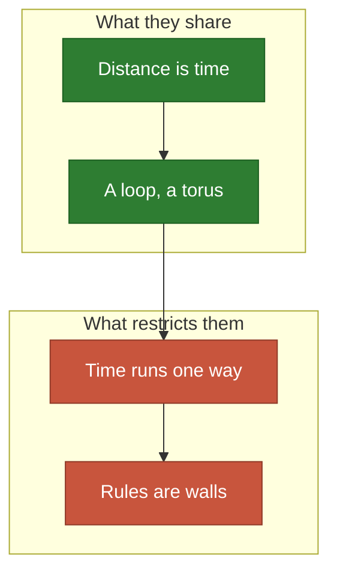
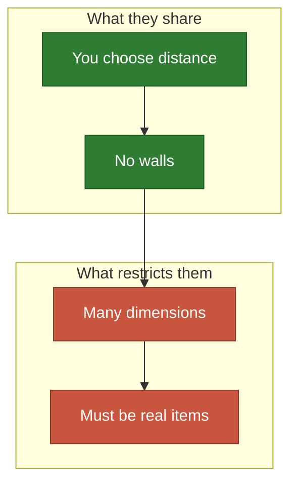
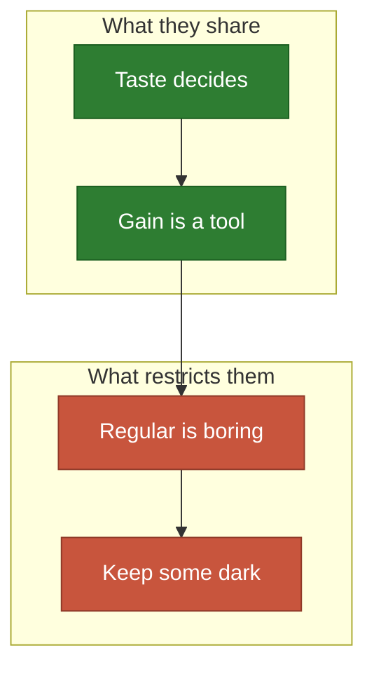

# No map at all

A calendar, a space of ideas, and a game: the space does not have to be a place.

**[sketch]** Rows are unchecked unless marked `Done`; the legend is in
[the map](README.md).

## A calendar

The space is time, and a [torus](../model/manifolds.md) loops by itself.

- **Share**: a day or a year as a circle, and a dose that decays like a signal.
- **[guess]** No new domain for a symmetric law.
- **Restricted by**: a dose helps after and not before, so the law is one-sided;
  and rest rules act as walls.

| # | Application | Emitter | Wants it | Blocks | The idea | Needs |
| ---: | --- | --- | --- | --- | --- | --- |
| 107 | 💊 Doses of a medicine | A dose | Waking hours | Meals | A day is a circle | `Laws` |
| 108 | 🚌 Bus timetable | A departure | Demand by hour | Night | Waiting time is a distance | `Laws` |
| 109 | Nurse shifts | A shift | Patients by hour | Rest rules | Rules are walls in time | `Place` |
| 110 | Watering times | A watering | Heat of the day | Noon | The first case, on the clock | `Laws` |
| 111 | 📰 Newsletters | A send | Readers' attention | Weekends | Too many annoy: dome-shaped $\psi$ | `Laws` |
| 112 | Revision sessions | A session | What fades | Exams | Spaced repetition, as coverage | `Time` |
| 113 | 🏖️ Holidays in a year | A break | Tiredness | School terms | A year is a circle too | `Place` |

## A space of ideas

Give any set of things a distance, and they become a map.

- **Share**: the law says how far one example stands in for another.
- **Often**: three dimensions fit today (colours), and more do not.
- **Restricted by**: no grid survives many dimensions, and a product or a
  sentence must really exist.

| # | Application | Emitter | Wants it | Blocks | The idea | Needs |
| ---: | --- | --- | --- | --- | --- | --- |
| 114 | 🎨 Colours of a palette | A colour | An image's colours | Nothing | Colour space is a volume today | `Laws` |
| 115 | 🖋️ Stippling a portrait | A dot | The photograph | Nothing | Dots drawn by the dark parts: art | `Laws` |
| 116 | A blue-noise texture | A dot | A periodic tile | Nothing | The torus is ready for it | `Laws` |
| 117 | Products in a range | A product | Customer tastes | Nothing | Too close and they compete | `Domain` |
| 118 | 🧪 Test cases | A test | Input space | Nothing | Coverage, in the literal sense | `Domain` |
| 119 | Summaries of a text | A sentence | All sentences | Nothing | A summary covers what it stands for | `Domain` |
| 120 | Examples to label | An example | Unlabelled data | Nothing | Active learning, as placement | `Domain` |
| 121 | Trials of a parameter | A trial | A search space | Nothing | Experiment design | `Domain` |
| 122 | Courses in a curriculum | A course | Skills needed | Prerequisites | Prerequisites are walls | `Domain` |
| 123 | 🎹 Chords in a scale | A chord | Musical space | Nothing | The circle of fifths is a torus | `Laws` |

## Games and art

The gain is a tool here, not the goal.

- **Share**: a good answer is one somebody enjoys.
- **Often**: the optimum is too tidy, so one wants less of it.
- **Restricted by**: taste, which no law states; use the engine for a first
  draft.

| # | Application | Emitter | Wants it | Blocks | The idea | Needs |
| ---: | --- | --- | --- | --- | --- | --- |
| 124 | 🔦 Torches in a dungeon | A torch | The corridors | 🧱 Walls | Keep some darkness on purpose | `Objective` |
| 125 | 🪙 Loot on a level | A chest | Player paths | 🧱 Walls | Too regular is boring | `Objective` |
| 126 | Respawn points | A spawn | The arena | 🧱 Walls | Far from danger, close to action | `Objective` |
| 127 | 🎧 Sound art in a park | A speaker | Walkers | Trees | Beauty has no gain, only a law | `Laws` |
| 128 | ⛲ Fountain jets | A jet | A basin | Nothing | The emitter is the show | `Time` |
