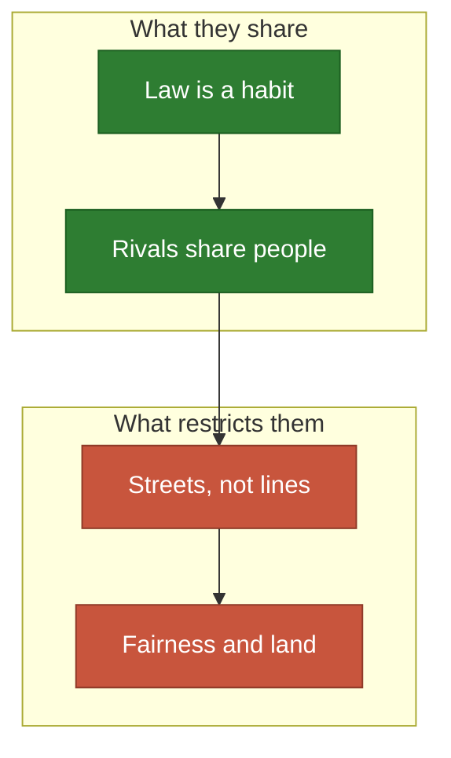
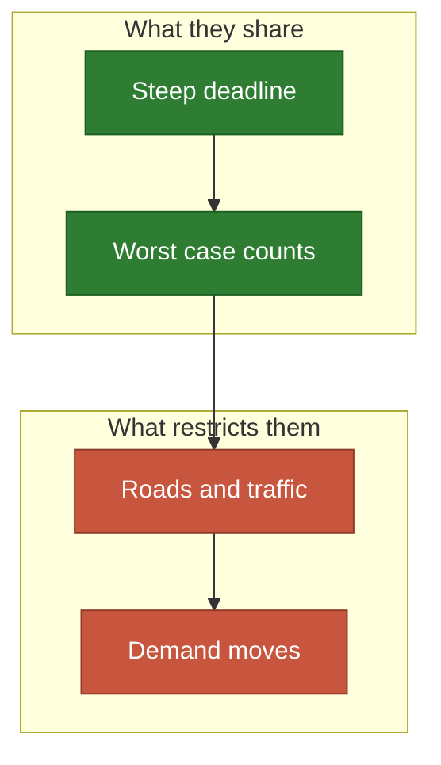

# People who walk

Services and rescue: the law is behaviour, and the distance is a street.

**[sketch]** Rows are unchecked unless marked `Done`; the legend is in
[the map](README.md).

## A city's services

People who walk to something, out of habit more than physics.

- **Share**: the law is observed rather than derived, and several emitters split
  one crowd.
- **Often**: a river or a highway acts as a wall.
- **Restricted by**: road distance, capacity, free land, and who is left out.

| # | Application | Emitter | Wants it | Blocks | The idea | Needs |
| ---: | --- | --- | --- | --- | --- | --- |
| 40 | 🛒 Shops in a neighbourhood | A shop | Households | 🌊 Rivers | Rivals share the same people | `Laws` |
| 41 | 🥐 Bakeries | A bakery | Morning walkers | Rails | People pass by, they do not go | `Domain` |
| 42 | 💊 Pharmacies | A pharmacy | The elderly | Highways | Nobody left too far | `Objective` |
| 43 | 🏫 Schools | A school | Children | Rail lines | A capacity per emitter | `Objective` |
| 44 | 🚌 Bus stops | A stop | Homes | Blocks | Stops must lie on the line | `Place`, `Domain` |
| 45 | 🚲 Bike stations | A station | Trips | 🌊 Rivers | Demand has two ends | `Pairs` |
| 46 | 🔌 Charging stations | A charger | Parked cars | Private land | The grid limits the sum | `Objective`, `Place` |
| 47 | 🪑 Benches on a long walk | A bench | Walkers | Nothing | The gap matters more than the mean | `Objective`, `Domain` |
| 48 | ⛲ Public fountains | A fountain | Hot places | Buildings | A map of need and of heat | `Laws` |
| 49 | Public toilets | A toilet | Crowds | Blocks | A long way is unbearable: steep $\psi$ | `Laws` |
| 50 | 🗑️ Bins in a park | A bin | Picnic lawns | Hedges | Past some distance nobody walks | `Laws` |
| 51 | 🛝 Playgrounds | A playground | Children | Roads | Crossing a road is a wall | `Laws` |
| 52 | 📚 Libraries | A library | Readers | Districts | The law is a habit, not physics | `Laws` |
| 53 | 🗳️ Polling stations | A station | Voters | 🌊 Rivers | Fairness is the whole point | `Objective` |
| 54 | Street trees | A tree | Pavements | Cables | Benefit is measured by the metre | `Place` |

## Rescue

A deadline: past it, the signal is worth nothing.

- **Share**: a law close to a cliff, and a mean that hides the one street nobody
  reaches.
- **Often**: a rare event, so the map is a risk rather than a crowd.
- **Restricted by**: minutes by road, and a map that changes during the crisis.

| # | Application | Emitter | Wants it | Blocks | The idea | Needs |
| ---: | --- | --- | --- | --- | --- | --- |
| 55 | 🏊 [Lifeguards](../../docs/cases/beach.md) | A post | Swimmers | Rocks | The chance someone gets there | `Done` |
| 56 | ❤️ Defibrillators | A cabinet | Busy streets | Doors | Four minutes, then too late | `Laws` |
| 57 | 🚒 Fire stations | A station | Buildings | 🌊 Rivers | Minutes by road, not metres | `Domain` |
| 58 | 🚑 Ambulances on standby | An ambulance | Calls | Traffic | It moves back after each call | `Time`, `Domain` |
| 59 | 🚭 Smoke detectors | A detector | Bedrooms | Doors | A detector listens | `Laws` |
| 60 | Exit signs | A sign | A smoky corridor | Corners | A sign must be seen in sequence | `Domain` |
| 61 | Fire lookouts | A tower | Forest | Ridges | Height and sight line | `Domain` |
| 62 | Flood sirens | A siren | Low homes | ⛰️ Hills | Demand is the risk map | `Laws` |
| 63 | 🏔️ Mountain huts | A hut | Hikers | Passes | Distance is effort, uphill counts | `Domain` |
| 64 | Sandbag depots | A depot | Levees | Floods | The map changes during the crisis | `Time` |
