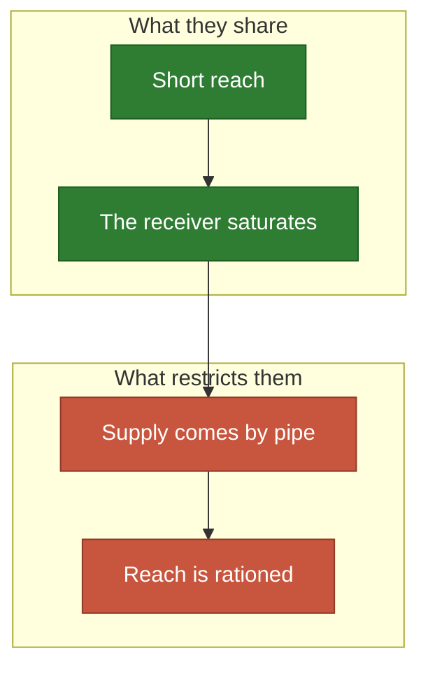
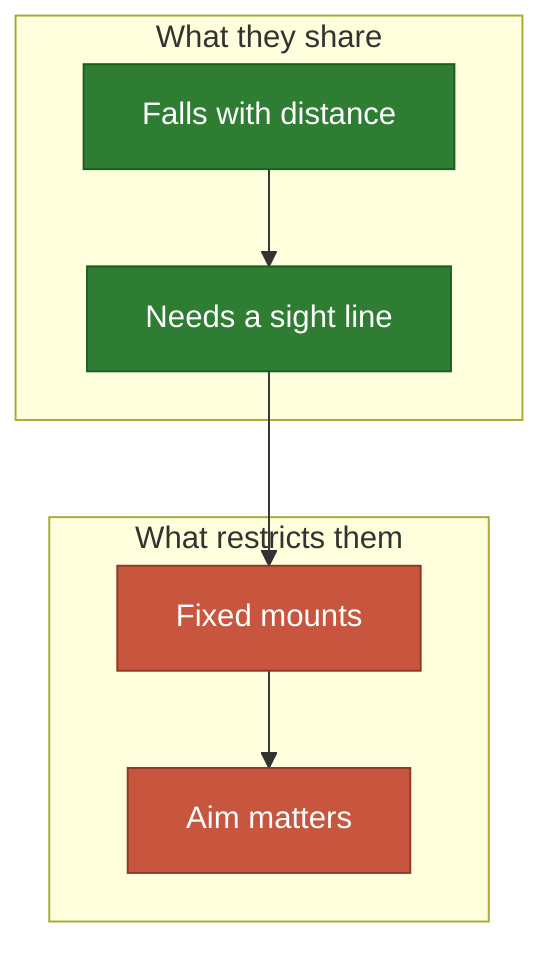
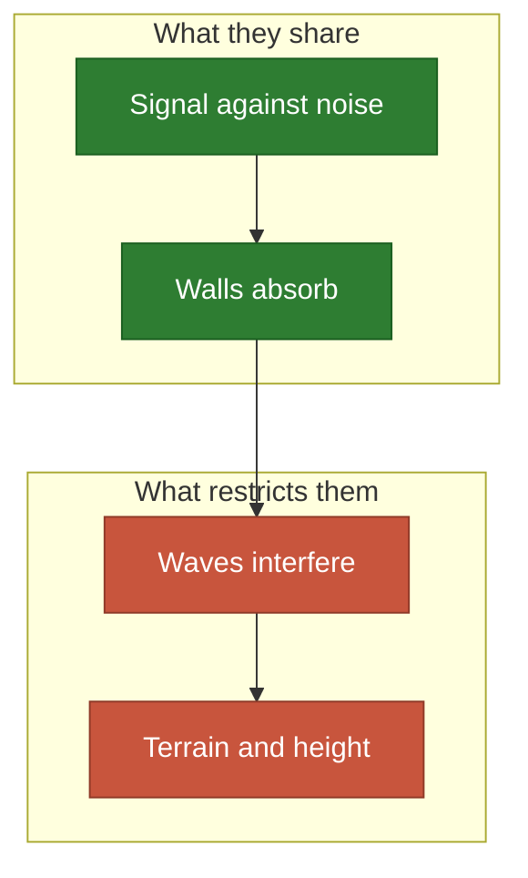

# Things that spread

Water, light and waves: the physics the engine was born for.

**[sketch]** Rows are unchecked unless marked `Done`; the legend is in
[the map](README.md).

## Water that feeds plants

Things that feed something alive.

- **Share**: a short reach, and a receiver that stops gaining once it has
  enough.
- **Often**: too much harms, so $\psi$ can turn back down.
- **Restricted by**: the pipe, the path, the farmer's walk.

| # | Application | Emitter | Wants it | Blocks | The idea | Needs |
| ---: | --- | --- | --- | --- | --- | --- |
| 1 | 💧 [Water that feeds plants](../../docs/cases/plants.md) | A water source | Each plant | Nothing | A plant drinks only so much | `Done` |
| 2 | 🌱 [Sprinklers in a garden](../../docs/cases/garden.md) | A sprinkler | The beds | Sheds | A second dose drowns the bed | `Done` |
| 3 | Drip lines in an orchard | A dripper | Tree roots | Nothing | Water must run along a pipe | `Place` |
| 4 | 🌾 Fertilizer in a field | A spreader stop | Yield map | Nothing | A dose too high burns the crop | `Laws` |
| 5 | Lamps in a greenhouse | A grow lamp | Benches | Other plants | Light has a saturation, like water | `Laws` |
| 6 | 🐝 Beehives on a farm | A hive | Flowers | Nothing | Bees tire with distance | `Laws` |
| 7 | 🐄 Water troughs for cattle | A trough | Pasture | Fences | Grazing follows the water | `Laws` |
| 8 | Shelter trees | A row of trees | Fields | Nothing | A tree is an anisotropic emitter of shade | `Aim` |
| 9 | 🐟 Aerators in a fish pond | An aerator | Fish density | Banks | Oxygen is what spreads | `Laws` |
| 10 | Feeders in a fish farm | A feeder | The school | Nets | The demand moves toward the food | `Time` |
| 11 | 🐦 Scarecrows | A scarecrow | Crop rows | Hedges | It works by fear, which fades | `Time` |
| 12 | 🌲 Seed drops for reforestation | A drone drop | Bare slopes | Ridges | A seed spreads by wind, one way | `Aim` |

## Light and heat

Energy that falls off with distance and needs a sight line.

- **Share**: an inverse-square shape, and shadows behind what blocks it.
- **Often**: a threshold (lit or not) or a comfort band (too hot, too cold).
- **Restricted by**: the ceiling, the kerb, the roof; and a lamp usually aims.

| # | Application | Emitter | Wants it | Blocks | The idea | Needs |
| ---: | --- | --- | --- | --- | --- | --- |
| 13 | 🚢 [Lamps on a quay](../../docs/cases/harbor.md) | A lamp | Quays | House fronts | Lit or not: a threshold | `Done` |
| 14 | 💡 Street lighting | A pole | Pavements | Trees | Poles stand on the kerb only | `Place` |
| 15 | Lamps in a room | A lamp | Where you read | Furniture | The ceiling is the only place | `Place` |
| 16 | 🎭 Stage lighting | A spot | The actors | The set | A spot aims, and actors move | `Aim`, `Time` |
| 17 | 📸 A photo studio | A flash | The subject | The subject | A shadow can be the goal | `Aim`, `Objective` |
| 18 | 🪞 Mirrors in a dark courtyard | A mirror | The ground | Buildings | A mirror emits what it receives | `Aim` |
| 19 | 🔥 Radiators in a flat | A radiator | Rooms | 🧱 Walls | Walls absorb rather than block | `Laws` |
| 20 | Heaters on a terrace | A heater | Tables | Nothing | Comfort falls on both sides | `Laws` |
| 21 | 🥖 Burners in an oven | A burner | The bread | The tray | Too much burns: a dome-shaped $\psi$ | `Laws` |
| 22 | Fans on a circuit board | A fan | Hot chips | Heat sinks | Air follows a flow, not a line | `Domain` |
| 23 | ☀️ Solar panels on a roof | A panel | Roof area | Chimneys | The sun moves; the panel does not | `Time`, `Place` |
| 24 | 🌳 Shade trees in a heatwave | A tree | People on foot | Buildings | Shade is a signal too | `Laws` |
| 25 | Cool shelters in a city | A shelter | Elderly people | 🌊 Rivers | The worst-off block decides | `Objective` |

## Radio and sound

Waves heard above a noise.

- **Share**: the sensor reads a ratio, so its law is often a logarithm.
- **Often**: walls attenuate rather than stop.
- **Restricted by**: interference, which the sum of signals ignores today.

| # | Application | Emitter | Wants it | Blocks | The idea | Needs |
| ---: | --- | --- | --- | --- | --- | --- |
| 26 | ⛵ [Wi-Fi in a marina](../../docs/cases/marina.md) | An access point | Boats and streets | Blocks | Diminishing returns | `Done` |
| 27 | [Wi-Fi in a building](../../docs/cases/building.md) | An access point | Offices | Concrete | Walls absorb | `Done` |
| 28 | 📶 Wi-Fi at home | A router | Sofa and desk | 🧱 Walls | The socket decides | `Place` |
| 29 | 📡 Cell towers | A tower | Population | ⛰️ Hills | Height changes everything | `Domain` |
| 30 | LoRa gateways on a farm | A gateway | Sensors | Terrain | Very far, very thin | `Laws` |
| 31 | [Radio stations on Earth](../../docs/cases/globe.md) | A station | Cities | The horizon | Only the distance changes | `Done` |
| 32 | 🛰️ Satellites | A satellite | People | The Earth | Emitters move on a fixed orbit | `Time`, `Place` |
| 33 | 🎵 Speakers in a concert hall | A speaker | Seats | Pillars | Two speakers can cancel | `Pairs`, `Aim` |
| 34 | Speakers at home | A speaker | The sofa | Furniture | One seat, not a surface | `Laws` |
| 35 | 🚨 [Sirens in a town](../../docs/cases/ramparts.md) | A siren | Residents | Ramparts | Heard above the noise | `Done` |
| 36 | Station announcements | A speaker | Platforms | Trains | Echo is an enemy | `Pairs` |
| 37 | Noise masking in an office | A masker | Desks | Partitions | Sound that protects privacy | `Laws` |
| 38 | Beacons for indoor location | A beacon | Corridors | 🧱 Walls | Three must be heard at once | `Objective` |
| 39 | GPS on a building site | A local beacon | The site | Cranes | The geometry of the set matters | `Objective`, `Pairs` |
