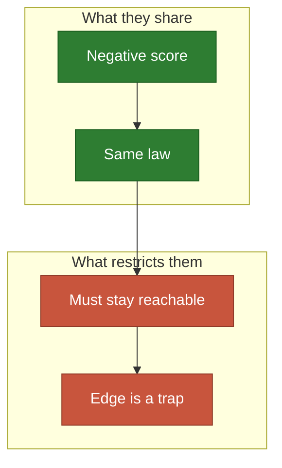
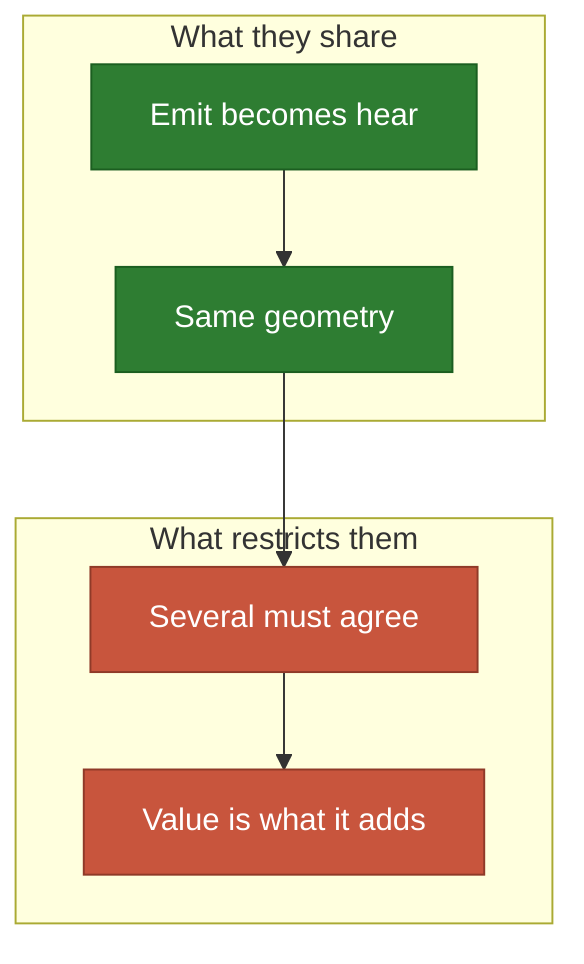
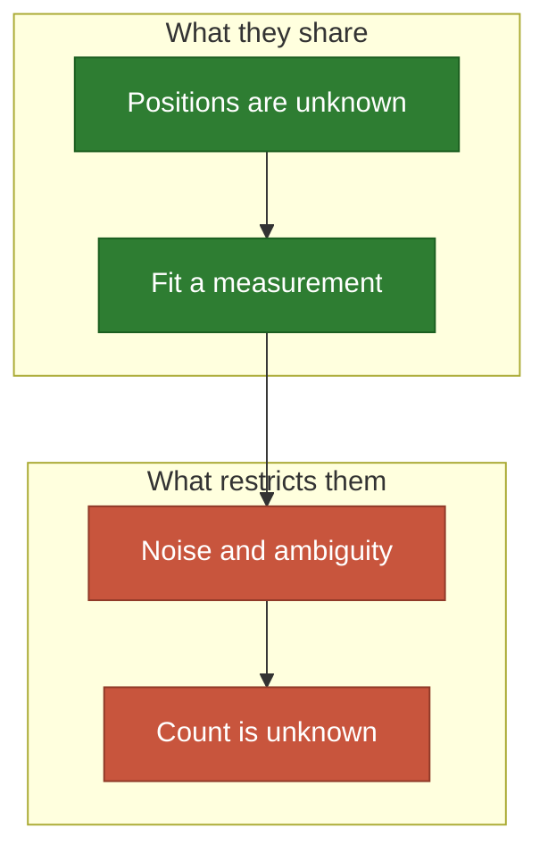

# The problem turned over

Same engine, another sentence: harm, listening, and hidden sources.

**[sketch]** Rows are unchecked unless marked `Done`; the legend is in
[the map](README.md).

## Harm to spare

Keep the law, change the sign of $\psi$: now each place loses.

- **Share**: the same engine, with a score that falls as signal rises.
- **[guess]** With harm alone the answer is trivial: as far as the map allows.
- **Restricted by**: the need to stay useful, so a real gain has two terms.

| # | Application | Emitter | Wants it | Blocks | The idea | Needs |
| ---: | --- | --- | --- | --- | --- | --- |
| 84 | A noisy compressor | The machine | Quiet offices | 🧱 Walls | Put the harm where it hurts least | `Laws` |
| 85 | A landfill | The landfill | Homes to spare | ⛰️ Hills | It must still be reached by road | `Objective`, `Domain` |
| 86 | 🌬️ Wind turbines | A turbine | Homes to spare, wind | ⛰️ Hills | One steals the wind of the next | `Pairs`, `Objective` |
| 87 | 🏭 A chimney | A chimney | Lungs to spare | ⛰️ Hills | Wind makes the law one-sided | `Aim` |
| 88 | ✈️ Airport noise | A runway | Sleep to spare | Nothing | A runway is an emitter with a heading | `Aim` |
| 89 | A busy nightclub | The club | Neighbours to spare | Blocks | Serve one crowd, spare another | `Objective` |
| 90 | Rival shops | Your shop | Clients, away from a rival | 🌊 Rivers | The rival is a fixed emitter | `Pairs` |

## Listening

A sensor covers the places it can hear: same geometry, other sentence.

- **Share**: placing a listener is placing an emitter, read backwards.
- **Often**: the event is rare, so the map is where it might start.
- **Restricted by**: locating an event takes several sensors at once, which a
  mean does not reward.

| # | Application | Emitter | Wants it | Blocks | The idea | Needs |
| ---: | --- | --- | --- | --- | --- | --- |
| 91 | 🌧️ Rain gauges | A gauge | A catchment | Ridges | Cover where the flood is born | `Laws` |
| 92 | 🌍 Seismometers | A station | Fault lines | Nothing | Three must hear it to locate it | `Objective` |
| 93 | Air quality sensors | A sensor | Schools | Blocks | The value of a sensor is what it adds | `Laws` |
| 94 | 🌊 Ocean buoys | A buoy | Currents | Coasts | The sphere, and the drift | `Time` |
| 95 | 🦌 Camera traps | A camera | Animal paths | Trees | A cone, not a disc | `Aim` |
| 96 | 🎤 Microphones on a stage | A microphone | The actors | Nothing | Two too close will interfere | `Pairs` |
| 97 | Museum blind spots | A guard post | Fragile works | 🧱 Walls | The art gallery problem | `Laws` |
| 98 | 🔭 Telescope array dishes | A dish | Fourier plane | Terrain | Pairs of dishes are what cover | `Pairs` |
| 99 | Pipe leak sensors | A sensor | The network | Valves | A map that is a graph | `Domain` |

## Hidden sources

The positions exist and you do not know them: fit them to a measurement, as
[urea](../model/urea.md) does.

- **Share**: the density is measured, and the emitters explain it.
- **Often**: the answer lies off the grid, where the descent shines.
- **Restricted by**: noise, ambiguous data, and not knowing how many sources
  there are.

| # | Application | Emitter | Wants it | Blocks | The idea | Needs |
| ---: | --- | --- | --- | --- | --- | --- |
| 100 | 🏭 A pollution source | The factory | A map of readings | Wind | Who is responsible | `Aim` |
| 101 | 🦠 An outbreak's origin | Patient zero | Cases on a map | Travel | Distance is contact, not metres | `Domain` |
| 102 | 📱 A lost phone | The phone | Signal strengths | 🧱 Walls | The same walls as the Wi-Fi case | `Laws` |
| 103 | ⭐ Stars in a blurred image | A star | The image | Nothing | Off-grid, like the atoms | `Laws` |
| 104 | 🔬 Cells in a microscope | A molecule | Blurred light | Nothing | Super-resolution, as a descent | `Laws` |
| 105 | Sources of a sound | A voice | A microphone array | 🧱 Walls | Many sources, one room | `Pairs` |
| 106 | Heat leaks in a house | A leak | A thermal image | Nothing | Inspect without a walk through | `Laws` |
