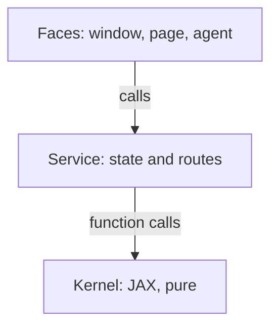

# Layers

**[sketch]** Three layers, dependencies pointing down only.

## Rules

- **`kernel/` never imports `gui/` or `service/`.** It prints nothing; a caller
  renders. A figure is a value it returns, not a window it opens.
- **`service/` owns the mutable state**: the current map, the emitters, the
  history, the seed. The kernel is pure: same inputs, same outputs.
- **`ui/` owns nothing** it cannot recover from `GET /api/state`.
- **An agent is a client of `service/`**, exactly like the window
  ([agent-interop](agent-interop.md)). No privileged path.

## Consequences

- The engine is testable without a display, so the suite is fast and the CI
  is boring.
- The window can be replaced without touching the model, and the model can be
  rewritten without touching the window.
- A script, a notebook, an agent and the window share one behaviour, because
  they call one function.
