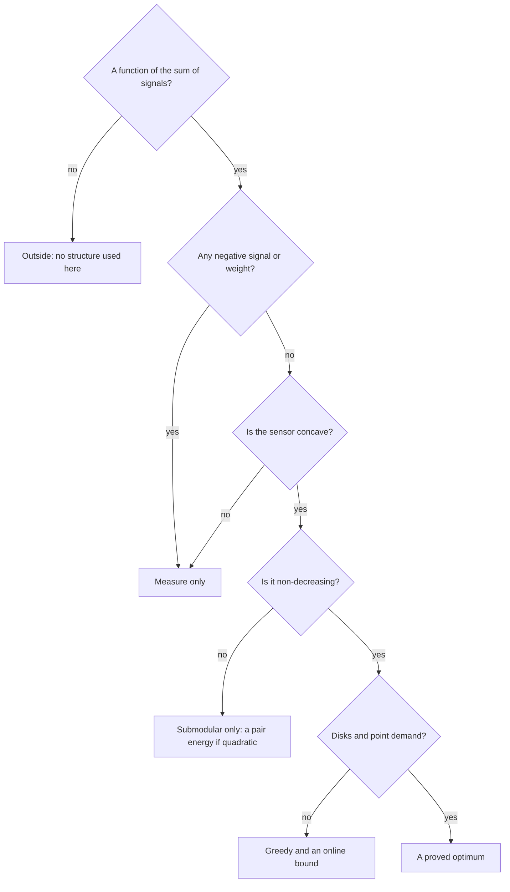

# Assumptions: a family of problems is a set of constraints

**[sketch]** The catalogue groups 128 uses; this folder says what grouping buys.

A family is a set of **constraints on the parameters of the gain**, and a
constraint gives a **consequence**: a guarantee, a solver, or the reason for a
trap.

$$
\mathcal G(U) = \int_E \psi(\sum_y \varphi(d(x, y)) \, pass_C(x, y)) \, d\mu(x)
$$

## The six axes

| Axis | What is constrained | What it decides | Page |
| --- | --- | --- | --- |
| $\psi$ | Shape of the sensor | Which guarantee exists | [laws](laws.md) |
| $\varphi$ | Shape of the emitter | Whether a gradient sees anything | [laws](laws.md) |
| $\mu$ | The map: atoms, support, sign | Whether the problem splits, or is finite | [space](space.md) |
| $C$ | Shadows: sharp, absorbing, closed rooms | Continuity of the gain | [space](space.md) |
| $E, d$ | Manifold, symmetry, dimension | What becomes constant, what explodes | [space](space.md) |
| Scales | Ratios of lengths | Which regime you are in | [scales](scales.md) |

## What is true of each simulated case

The shape of $\psi$ is tested on each photograph case in
`tests/test_case_classes.py`; the other rows are read from the code.

| Case | $\varphi(d)$ | $\psi(s)$ | $\psi$ class | $C$ | $E$ |
| --- | --- | --- | --- | --- | --- |
| Plants | Gaussian | $1 - e^{-ts}$ | Saturating | None | Plane |
| Beach | Gaussian | $1 - e^{-s}$ | Saturating | Sharp | Plane |
| Marina | $1 / (1 + (d/a)^2)$ | $\log(1 + s/n)$ | Saturating | Sharp | Plane |
| Building | $1 / (1 + (d/a)^2)$ | $\log(1 + s/n)$ | Saturating | Absorbing | Volume |
| Globe | $e^{\kappa (\cos d - 1)}$ | $1 - e^{-s}$ | Saturating | None | Sphere |
| Garden | $(1 - (d/a)^2)_+^2$ | $1 - (1 - s)^2$ | Dome | Sharp | Plane |
| Sphere | $e^{\kappa (\cos d - 1)}$ | $1 - (1 - s)^2$ | Dome, homogeneous | None | Sphere |
| Urea | Gaussian | $s - c s^2 / 2$ | Dome | None | Torus |
| Harbor | $(1 + (d/a)^2)^{-3/2}$ | Logistic in $s$ | S-shaped | Sharp | Plane |
| Ramparts | Spreading, absorption | Logistic in decibels | S-shaped | Sharp | Plane |

## What each family assumes

**[sketch]** Typical constraints, read from the rows of
[the catalogue](../../applications/README.md). A row can break its family.

| Family | Usual $\psi$ | Usual $\varphi$ | Space and shadows | Consequence |
| --- | --- | --- | --- | --- |
| Water | Dome | Compact | Plane, few walls | Blind past its reach; a surplus hurts |
| Light and heat | S-shaped or dome | Power law | Sharp shadows | Weak guarantees; synergies |
| Radio and sound | Saturating | Heavy tail | Absorbing | The most guarantees of the physical families |
| A city's services | $s / (s + r(x))$ | Exponential | A road metric | Concave at each place if rivals stay fixed |
| Rescue | Saturating | Near a step | Sharp | Near exact coverage; a mean hides the worst street |
| The body | Signed $\mu$ | Varied | Absorbing | A difference of two good terms: no guarantee |
| Machines and matter | Quadratic | Gaussian | Manifolds | A pair energy; truth is checkable |
| Harm to spare | Decreasing | Any | Any | Pushed to the boundary |
| Listening | Saturating, or $k$ of $n$ | Any | Any | Saturating is easy; $k$ of $n$ is S-shaped |
| Hidden sources | $\log$ | Normalized | Measured $\mu$ | A maximum likelihood |
| A calendar | Saturating | One-sided | A one-dimensional torus | Exact on small cases; symmetric when uniform |
| A space of ideas | Saturating | Similarity | Many dimensions | Candidates are items: greedy, no grid |
| Games and art | Any | Any | Any | The optimum is a draft |

## The order of the questions

A person with a new problem can read their guarantee from this order.

