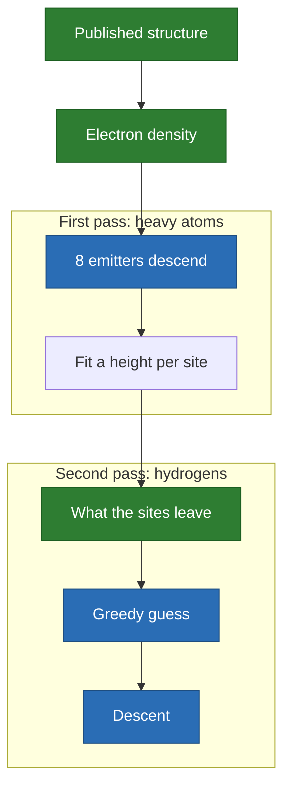

# A molecule: finding the atoms of urea

**[measured]** The emitters find the 16 atoms of a urea cell in its electron
density, within 0.03 angstrom. This is real-space refinement, on a torus.

## The setting

- **Domain**: a `Torus` of 5.565 x 5.565 x 4.684 angstrom, 24 x 24 x 20 cells.
- **Density**: Gaussians weighted by electrons, built from the 12 K neutron
  structure of Swaminathan, Craven and McMullan, Acta Cryst. B40, 300 (1984).
- **Emitter**: a Gaussian of 0.35 angstrom, as wide as an atom in the density.
- **Sensor**: $\psi(s) = s - s^2/2$, so a second emitter on a peak adds nothing.

## What is measured

| Atoms | Method | Worst error |
| --- | --- | --- |
| 8 heavy | greedy on a 12 x 12 x 10 grid | 0.391 angstrom |
| 8 heavy | descent, 12 starts | 0.028 angstrom |
| 8 hydrogens | greedy on the residual, then descent | 0.023 angstrom |

- The heights read at the sites give 5.95, 7.29 and 8 electrons when oxygen is
  set to 8, which names carbon, nitrogen and oxygen correctly.
- **The grid is 0.23 angstrom wide**: the descent lands far inside a cell, which
  no grid search can do. This is where the descent earns its place.

## [caution]

- **The density is synthetic.** It holds no noise, no thermal smearing, and no
  phase problem: a real map has to be solved before this step starts.
- **Free descent misses hydrogens**: 6 of 8 from 32 starts. It takes the greedy
  guess on the residual to get all 8.
- It says nothing about the anharmonic displacement of an atom, only about where
  the atom sits.
- **[question]** Real data is the next step: a map computed from measured
  reflections, with its own error ([open](../open.md)).
