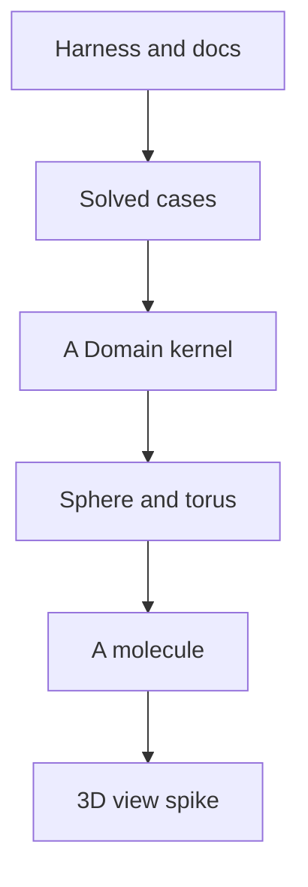

# Roadmap

**[sketch]** The ordered steps. An agent starting a session takes the first
unchecked step, reads the files it names, and works without asking. A step is
done when `just agent gate` passes **and** its acceptance sentence is true.

## Current state

**[fact]** 2026-11-04, v2.3.0. The CLI, the local service and the DearPyGui
window run on the JAX kernel; five cases come from aerial photographs. The
kernel works on a plane, a sphere, a torus and a volume through one `Domain`.

## How to resume

1. Read [AGENTS.md](../AGENTS.md), then [ideas/README.md](README.md), then this
   file.
2. `git status`, `just agent gate`: the gate must be green before a step.
3. Work on `dev/<topic>`. `main` is always valid: merge it each time a step
   passes the gate, so that any stopping point can be judged from `main`.
4. A step ends with a `CHANGELOG.md` entry under `## Unreleased` and this file
   updated.
5. A question that belongs to the author goes to [open.md](open.md).
6. Never open a window from a session: a window takes the author's focus. Test
   a face headless.

## The order

The README is close to its final form: a step adds to it and never restructures
it. The science comes before the packaging.

## Step 1 — harness and docs

- [x] **1.1 CI, disabled.** `.github/workflows/check.yaml` and `.gitlab-ci.yaml`
  run by hand only; activation is the author's consent, since nobody follows
  the project yet and a run should not be billed.
- [x] **1.2 `just audit`.** The lock, the known vulnerabilities, the licences.
  It asks the network, so it stays out of the gate.
- [x] **1.3 Markdown.** The markdown rule, its smell check and Mermaid.
- [x] **1.4 The docs tell the truth** about the stack and the faces.

## Step 2 — the cases are solved, and it shows

- [x] **2.1 Convergence.** Each case descends until it stops improving.
  *Accepts*: a measured curve per case, and the emitters visibly travel.
- [x] **2.2 A baseline per case** ([baselines](model/baselines.md)).
  *Accepts*: a table of our gain against a greedy and a random placement.
- [x] **2.3 A case by name** in the CLI, the service and the window, with the
  right extent. *Accepts*: `emitter-optimizer run --case garden` works.
- [x] **2.4 Bad input is a message**, not a traceback. *Accepts*: a test per
  missing file, zero emitter and zero iteration.
- [x] **2.5 The published benchmark** lists the five cases.

## Step 3 — a kernel that does not know the plane

- [x] **3.1 A `Domain` `ABC`.** Points, measure, distance, projection; `Plane` is
  the first ([manifolds](model/manifolds.md)).
  *Accepts*: the plane gives the same gains as before.
- [x] **3.2 A volume.** A voxel density and an absorption field, in 3D
  ([three-dimensional](model/three-dimensional.md)).
  *Accepts*: a building case runs, with its time.

## Step 4 — manifolds

- [x] **4.1 The sphere.** Geodesic distance and projection.
  *Accepts*: Thomson's known optima are recovered: a tetrahedron for 4, an
  octahedron for 6, an icosahedron for 12.
- [x] **4.2 The torus.** A periodic cell and a lattice sum
  ([crystals](model/crystals.md)).
  *Accepts*: the truncated sum converges as the range grows.
- [x] **4.3 A case on a surface** a reader can picture, in the README.

## Step 5 — a molecule

- [x] **5.1 A molecular case**, with what it maximizes stated first
  ([constraints](model/constraints.md)).
  *Accepts*: a figure and a table a chemist can read.

## Step 6 — a 3D view

- [ ] **6.1 A spike on `spike/view3d`** ([faces](architecture/faces.md)).
  *Accepts*: candidates compared on measured criteria. The window is not
  removed by an agent: that decision is the author's.

## Later

- The wheel carries its default laws and cases; PyPI.
- Soft occlusion by default, richer objectives, the emitter count, a physics
  of anisotropy and noise ([objective](model/objective.md),
  [emitter-count](model/emitter-count.md), [physics](model/physics.md)).
- Circuits and interference ([circuits](model/circuits.md)).
- A Typst report.
